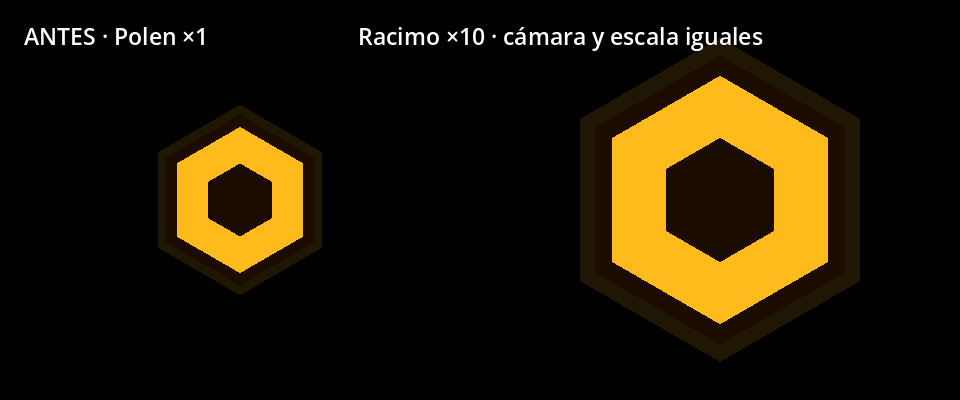
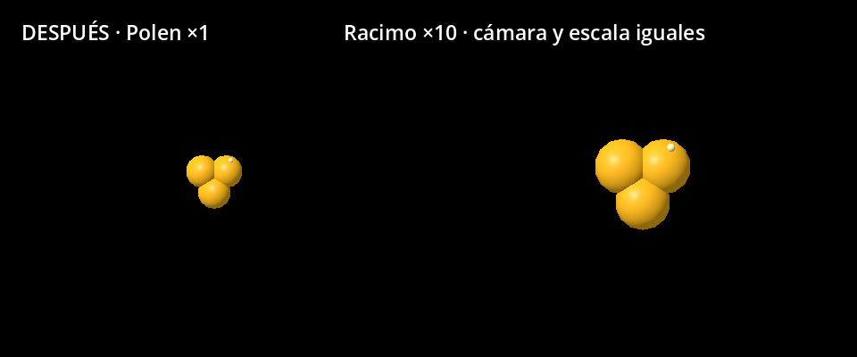
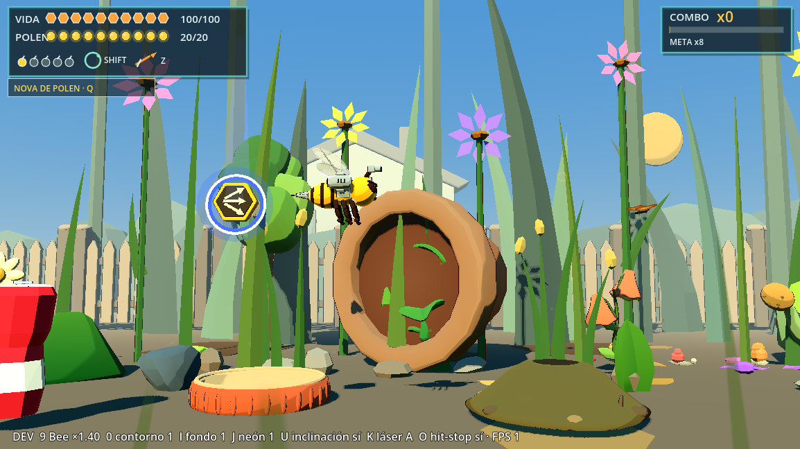
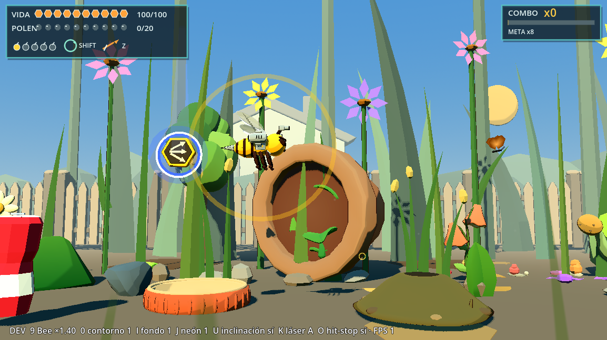
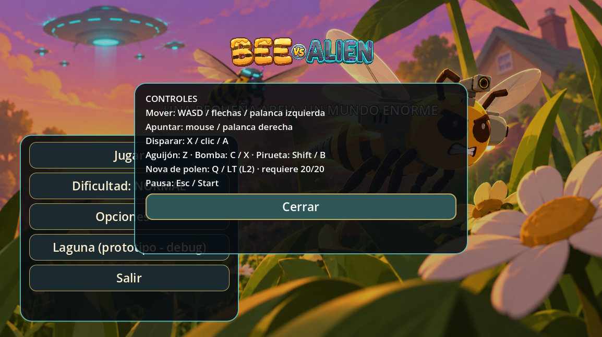

# T3m — Polen de tres granos y Nova de polen

Rama `lote-16-titulo-intro`. 15/10/2026. Se reemplaza el dibujo del polen y la recompensa de su barra por una Nova manual. No se crean modelos externos ni se modifican GLB o fuentes `.blend`.

## Auditoría previa

La forma hexagonal por sí sola no identifica el objeto. Antes de editar se revisaron los scripts de recolección, las escenas y las rutas de creación del nivel:

| Objeto real | Identificación | Valor / función anterior | Cambio T3m |
|---|---|---|---|
| Polen suelto | `BeePollenPickup`, `scenes/items/toon/pollen.tscn` | 1 polen, esfera de recolección de radio 0,48 m | Tres granos, diámetro aproximado de 0,34 m frente a 0,85 m |
| Racimo de polen | `BeePollenCluster`, `scenes/items/toon/pollen_cluster.tscn` | 10 polen, esfera de radio 0,70 m; visual 1,7 veces mayor | Mismo racimo de tres granos, escala relativa conservada; diámetro aproximado 0,58 m frente a 1,445 m |
| Polen del prototipo | `scenes/bee_prototype/pollen_pickup.tscn`, mismo script base | 1 polen, esfera de radio 0,28 m | Mismo reemplazo visual al 40 % |
| Polen soltado por flores, hongos y obstáculos | Creación mediante `BeeObstacleDrops`; recompensa de liberaciones vía `BeeLevel01Juice` | Alimenta la misma barra | Los pickups usan el nuevo visual; las recompensas numéricas cargan la Nova |
| Spread, Spread S+ y bomba | `BeePowerupPickup.Kind.SPREAD/BOMB`; escenas toon y medallones dinámicos | Armas/munición, no polen, aunque sus marcos también sean hexagonales | Sin cambios de diseño, tamaño, sonido ni función |

El suelto y el racimo podían confundirse por sus piezas/celdas hexagonales, pero ambos eran polen; la diferencia efectiva es **1 frente a 10**, no la cantidad de hexágonos dibujados. Los medallones de armas son otro sistema. Se conserva el recurso histórico `bee_pollen_hexagon.gd` para evitar mover archivos; su contenido ahora dibuja esferas y el nodo se llama `PollenGrains`.

Antes, cada múltiplo de 20 llamaba a `_heal_from_pollen()`: restauraba el 10 % de vida máxima, mostraba `+10% VIDA` y, con vida llena, guardaba una cura para el próximo daño. Se eliminaron tanto la curación al llenar como la cura guardada y su texto. Los contadores antiguos de telemetría quedan en cero por compatibilidad con informes/fixtures. El pickup genérico reutilizable conserva su antiguo parámetro `heal_amount=20`; el nivel 1 ya lo fija en cero y el racimo también tiene cero. T3m elimina la curación de la barra del nivel, sin cambiar los prototipos ajenos.

Se revisaron `project.godot`, el autoload `InputDevices` y los scripts de controles. Ya estaban ocupados WASD/flechas, X/clic/A/RT para fuego, Z/Y/RB para Aguijón, C/X del mando para bomba, Shift/B/LB para pirueta, Esc/Start y R/Y tras derrota. **Q** y el **gatillo izquierdo LT/L2** estaban libres y son los elegidos. La acción `bee_pollen_nova` se registra en el autoload, para todos los dispositivos, con umbral de gatillo 0,55; no se necesita editar el InputMap del archivo de proyecto. Pulsar activa una vez; mantener no produce repeticiones.

## Diseño y reglas finales

Tres granos redondos amarillo-dorados con emisión suave, giro de 0,28 rad/s, flotación de 0,04 m y un destello pequeño que pulsa. El tamaño usa `PICKUP_SIZE_FACTOR=0.4`; son cuatro mallas opacas pequeñas, sin luces ni sombras. Los modelos originales siguen conservados y ocultos. En el HUD, solo las celdas de polen pasan a granos redondos; los hexágonos de vida permanecen.

El imán T3i y el sonido `pollen` no cambian: mismo trigger, atracción 2,5 veces su radio, ampliación al rodar, aceleración suave, bloqueo por enemigos y retirada fuera de pantalla. El racimo sigue valiendo 10. Se conserva el límite de 70 polen por minuto y la recompensa de liberación una vez cada tres animales.

| Parámetro de Nova | Valor |
|---|---:|
| Carga y consumo | 20 polen; una única carga |
| Radio de efecto | 4 m, esfera real en XYZ |
| Expansión de la onda | 0,4 s desde la posición de Bee al activarla |
| Daño a comunes | 9 = 3 impactos base de 3 |
| Daño base a jefe/minijefe | 6 por componente de salud alcanzado |
| Invulnerabilidad de Bee | 0,3 s |
| Cooldown mínimo | 1 s |

La barra permanece en **20/20**, pulsa en dorado y muestra `NOVA DE POLEN · Q` o `LT/L2` debajo del panel, sin invadir el contador. Al activar vuelve a cero. El excedente recogido mientras está llena no guarda otra Nova. La suma histórica recogida se conserva para estadísticas. Pausa, derrota y victoria impiden activarla; no gastan la carga.

La onda elimina proyectiles enemigos del grupo `alien_projectiles`, incluidos los de jefe que también pertenecen a ese grupo, dentro de la esfera que va creciendo. Desactiva sus hitboxes antes de liberarlos. No elimina balas de Bee ni ataques que no sean proyectiles, como superficies de daño o redes persistentes.

El daño pasa por `DamageHurtbox3D` y deduplica por `HealthComponent`: cuerpo e implante compartidos reciben un solo golpe, sin multiplicación por punto débil. Los 6 de jefe son daño **base**: se respetan sus fases protegidas, armadura y presupuesto de daño existentes; no es daño porcentual de bomba ni evita el blindaje. La prueba usa una tarántula real activa y verifica exactamente 6 con presupuesto disponible. El Aguijón sigue haciendo 30 y no cambia su lógica. La protección de Nova tiene estado propio en `HealthComponent`, de manera que terminar una pirueta/Aguijón no la cancela ni terminar la Nova cancela esas protecciones.

Los ajustes están en `scripts/game/bee_pollen_nova_settings.gd` y `bee_pollen_settings.gd`. La onda se implementa en `scripts/bee_prototype/bee_pollen_nova.gd`; carga y activación en `bee_level_01_juice.gd`. Se agregó la acción a la pantalla de controles del título, la leyenda de controles del HUD y la ayuda de pausa.

## Capturas verificadas con render

Godot 4.7.2, renderer Compatibility, Intel Arc B580. Antes/después del pickup tomados con la misma cámara ortográfica, resolución y escala. El antes se capturó antes de editar; el después usa las escenas reales modificadas. Sin errores de script/shader en la captura final.

Antes:



Después:



Carga completa e indicador de Q:



Onda activa y barra gastada:



Pantalla de controles:



Herramienta de captura: `tools/polen_nova_review.gd`, con render; guarda resultados en `dev/t3m_*.png`. El argumento `-- before` corresponde a la captura histórica ejecutada antes del reemplazo, no activa un modo antiguo en el juego actual.

## Pruebas

Auditoría sin modificaciones: **6/7 dirigidas aprobadas**; `validate_bee_lote11_juice_v01` ya fallaba por acceder a `wave` de una escena nula. El registro previo completo de T6c tenía **88/132 aprobadas y 44 fallidas**.

Validación dirigida ampliada: las tres pruebas históricas `validate_bee_lote11_juice_v01`, `validate_bee_checkpoint_qol_v01` y `validate_bee_items_shots_v04` conservan sus fallos de fixtures/escena nula. Se actualizaron únicamente sus expectativas de polen reemplazadas por T3m; no se repararon sus problemas previos.

**9/9 pruebas funcionales finales aprobadas**: `validate_bee_t3m_pollen_nova`, `validate_bee_t3i`, `validate_bee_lote14_pollen_v01`, `validate_bee_t1b_hud`, `validate_bee_tanda4c_weapons`, `validate_bee_lote14_controls_v01`, `validate_bee_t4b`, `validate_bee_t6c_cloud` y `validate_bee_t2_flow`.

La nueva prueba cubre carga insuficiente, ausencia de cura, carga persistente, consumo, cooldown, protección antes/después de 0,3 s y su independencia del roll/Aguijón, esfera XYZ, deduplicación cuerpo/implante, inmunidad de aliados/protegidos, limpieza de balas comunes/de jefe, balas fuera del radio y balas propias conservadas, daño de jefe 6, bloqueo en pausa/derrota/victoria, bindings Q/LT y activación por el bucle de entrada real. T3i comprueba además tres granos y destello, reducción visual, valores de recolección e imán conservados.

## Suite completa final

Una única pasada completa: **89/133 aprobadas, 44 fallidas**, frente a **88/132 y 44 fallidas** en T6c. La validación nueva de Nova aprueba. **Cero fallos nuevos y cero reparaciones de casos históricos**: los 44 nombres coinciden exactamente con el registro de T6c/T6b; se conservan sus problemas previos de fixtures, expectativas de combate/VFX y jefes. La suite del repositorio sigue sin estar verde.

Ejecución headless con hasta tres procesos aislados y `APPDATA` por test; `--fixed-fps 60` salvo las excepciones históricas de toon items y avispa. Duración: **183,03 s**. Se contaron como fallo también los SCRIPT ERROR; 27 procesos con error de script persistente se cerraron, y hubo 0 timeouts. Resultados/logs locales en `dev/t3m_full_results.json` y `dev/t3m_full_*.log`; no se repitió la suite completa. `git diff --check` sin errores. Las capturas con render se revisaron visualmente.

## Cómo probar

Abrir `D:\proyectos\bee_alien_3d` con Godot 4.7.2. F5 → Controles permite leer la nueva acción; F6 sobre `scenes/levels/bee_level_01_vertical_slice.tscn` abre el nivel. Recoger polen hasta 20/20: no debe curar, la barra debe quedar llena y aparecer Q/LT. Pulsar Q o LT/L2 cerca de enemigos/balas: sale la onda, se vacía la barra, desaparecen las balas dentro de 4 m y los comunes reciben 9. Mantener el botón no repite. Esc muestra la ayuda de Nova.

Prueba automatizada principal, desde la raíz del proyecto:

```powershell
& 'C:\Users\rea_0\Downloads\Godot_v4.7.2-stable_win64.exe\Godot_v4.7.2-stable_win64_console.exe' --headless --fixed-fps 60 --path . --script res://tests/levels/validate_bee_t3m_pollen_nova.gd
```

Queda para playtest humano la lectura de los granos pequeños durante combate y el equilibrio de disponibilidad/daño de Nova. No se presenta una prueba automatizada como validación de diversión. El cambio local previo de `project.godot`, documentos ajenos y UIDs/importaciones automáticas ajenos quedan fuera del commit.
