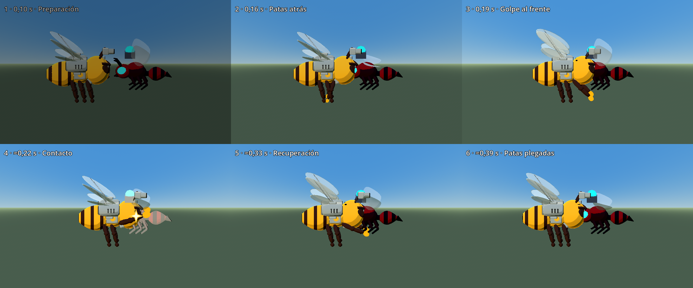

# T4g — Puñetazo de patas delanteras

Rama `lote-16-titulo-intro`. 15/10/2026. Cambio de presentación de la acción Z / Y / RB. La mecánica T4b, el sonido de impacto y el hit-stop local T4f se conservan.

## Auditoría del modelo y del golpe anterior

Se instanciaron e inspeccionaron los dos GLB admitidos por `BeeVisual`, sin editarlos:

| Modelo | Piezas delanteras separadas | Decisión |
|---|---|---|
| Activo v02: `assets/models/shared/bee_hero/shared_hero_bee_v02.glb` | `Leg_L_0_Upper`, `Leg_L_0_Lower`, `Leg_R_0_Upper`, `Leg_R_0_Lower`, `LegJoint_L_0`, `LegJoint_R_0`, `Foot_L_0`, `Foot_R_0` | Animar estas ocho piezas importadas |
| Alternativo v01: `assets/models/shared/bee/bee_mid_poly.glb` | Los cuatro segmentos `Leg_L/R_0_Upper/Lower`; sin pies/articulaciones adicionales separados | Animar sus cuatro piezas existentes |

Son `MeshInstance3D` independientes con transformaciones propias, no una sola malla fusionada. El índice 0 es el par delantero, en Z más negativo, hacia la cabeza. Los índices 1 y 2 son las otras patas y quedan intactos. **No hace falta un proxy procedural.** Las patas conservan su geometría y materiales; los pies del v02 se presentan como puñitos dorados durante la acción y recuperan su material al terminar.

Antes había dos representaciones superpuestas: un `ChromeStinger` procedural con cono y partículas plateadas en `BeePlayer`, y el taladro importado `Stinger/stinger_drill`, animación `drill_spin` y `BeeDrillMetalTrail` en `BeeVisual`. El impacto añadía efectos `bee_melee`, `bee_impact`, flash de escala del cono y chispas del taladro. Se retiraron esas construcciones, llamadas y animaciones del golpe. Los nodos de aguijón de ambos modelos se ocultan en ejecución; los GLB, clips originales y `.blend` se conservan sin modificación.

## Animación y sincronización

La pose depende de `phase` y `left` del controlador T4b. No tiene un reloj/tween independiente que pueda seguir animándose mientras el actor queda detenido por el hit-stop.

| Tiempo nominal desde Z | Mecánica T4b existente | Pose nueva |
|---|---|---|
| 0–0,10 s | Primer tramo del avance físico | Postura normal de aproximación |
| 0,10–0,16 s | Continúa el avance | Preparación de **0,06 s**, patas hacia atrás |
| 0,16–0,22 s | Final del avance | Golpe de **0,06 s**, patas al frente |
| 0,22–0,28 s | Ventana de contacto de **0,06 s** | Extensión máxima sostenida durante el contacto |
| 0,28–0,38 s | Retroceso físico de **0,10 s** | Recuperación de **0,10 s**, hasta restaurar la pose exacta |

La preparación no agrega una espera antes del dash. Se ubica al final del avance para alinear la extensión máxima con la apertura de la hitbox. El tiempo total mecánico nominal sigue siendo **0,38 s**. Los cambios de fase se resuelven por ticks físicos, como antes; las capturas muestran tiempos aproximados por esa discretización. El hit-stop local añade su pausa de reloj real sin consumir la fase física.

Se rotan las piezas delanteras alrededor de un hombro virtual, manteniendo su jerarquía original. Al extenderse se estiran visualmente hasta **1,45×**; los pies hasta **1,35×** adicional, para que el puño se lea por delante de la cabeza. No se mueve ni escala el cuerpo físico o la hitbox. Al terminar, incluso si Bee es derrotada durante el golpe, se restauran inmediatamente las transformaciones y materiales guardados. El par delantero sigue la orientación existente del cuerpo, incluidos objetivos detrás, arriba o abajo.

El impacto confirmado muestra una estrella de cuatro puntas, **radio 0,14 m**, borde dorado y centro blanco cálido, durante **0,10 s** en la posición de la hitbox de contacto. Mira a cámara y se dibuja sobre la superposición entre puño y enemigo para conservar la lectura. No añade rayos, estelas ni otro pulso grande; los flashes propios del enemigo siguen siendo los existentes. No aparece una estrella por un dash vacío.

`BeeJuice.key_event(..., "sting", ...)` continúa en el mismo callback de impacto real: pausa local de T4f y sacudida direccional sin modificar `Engine.time_scale`. Se conserva también el sonido `melee`. La animación de alas permanece en `wingbeat`; no se reemplaza por `drill_spin`.

## Contrato de gameplay conservado

| Parámetro | Valor existente, sin cambios |
|---|---:|
| Avance físico | 0,22 s |
| Contacto | 0,06 s |
| Retroceso | 0,10 s / 0,35 m |
| Daño base | 30 |
| Alcance para elegir objetivo | 2,08 m, blanco más cercano en 360° |
| Separación prevista al llegar | 0,45 m |
| Dash vacío | 1 m, sin daño |
| Hitbox | La misma `MeleeHitbox`, caja 0,75 × 0,50 × 0,50 m |
| Cooldown | Sin recarga adicional; disponible al terminar la maniobra |
| Protección | Invulnerable durante la maniobra |
| Pirueta | Espera mutua y solicitudes pendientes existentes |

`bee_sting_settings.gd`, la escena `bee_player.tscn`, los valores de daño y las condiciones de movimiento/contacto no cambian. En `bee_sting_dash.gd` solo se eliminan las dos llamadas del visual anterior y se restaura la pose al finalizar. No cambia Nova ni su protección independiente de T3m.

## Textos y archivos

HUD, consejo contextual, leyendas de teclado/mando y pantalla de controles del título dicen **Puñetazo**. El icono del HUD pasa del pinchazo a un puño. Se actualiza también el texto del POC de combate, sin cambiar su lógica. Los identificadores internos `sting`, `melee`, `debug_attack` y `stinger` pueden seguir existiendo por compatibilidad, tal como permite el pedido.

Configuración visual: `scripts/game/bee_punch_settings.gd`. Pose: `scripts/bee_prototype/bee_punch_pose.gd`. Estrella: `scripts/vfx/bee_punch_star.gd`. Integración localizada en `BeePlayer`, `BeeVisual` y las llamadas visuales de `bee_sting_dash.gd`. No se importan ni generan assets externos.

## Secuencia de seis cuadros

Captura con Godot 4.7.2 Compatibility/Intel Arc B580. Es un banco de poses y movimiento reales del nivel, con cámara cercana y escenario oculto para leer las patas; **no es una grabación de una partida**. La herramienta avanza en pasos físicos pequeños, conserva la selección del enemigo y las colisiones. La avispa empieza en 100 HP y termina en **70**, un único golpe de 30; Bee termina con `sting_dash.active=false`. El hit-stop se desactiva exclusivamente en el banco para muestrear fases con tiempos comparables; la prueba funcional comprueba que se mantiene en juego.

`tools/punetazo_secuencia.gd` produce `docs/punetazo_t4g_secuencia.png` (2400 × 1000). Se revisaron los seis cuadros; se distinguen preparación, retirada de patas, extensión, contacto con estrella, recuperación y postura restaurada. Sin errores de script/shader en la captura final.

## Pruebas dirigidas

Antes de editar: **5/5 aprobadas**, T4b, T4f, controles Lote 14, integración del héroe y Nova T3m. Base completa anterior T3m: **89/133 aprobadas, 44 fallidas**.

Después: **10/10 dirigidas aprobadas** (nueve iniciales y HUD Lote 17 revalidado): `validate_bee_t4g_punch`, `validate_bee_t4b`, `validate_bee_t4f`, `validate_bee_lote14_controls_v01`, `validate_bee_hero_integration_v01`, `validate_bee_t3m_pollen_nova`, `validate_bee_tanda4c_weapons`, `validate_bee_t1b_hud` `validate_bee_weapons_powerups_v01` y `validate_bee_lote17_hud_v01`.

La nueva prueba comprueba las piezas reales de ambos modelos, ausencia del cono/taladro visible, tiempos de preparación/golpe/recuperación, extensión al contacto, patas medias/traseras intactas, restauración exacta, hitbox y contrato T4b conservados, estrella de 0,1 s en el contacto, ausencia de daño adicional por el callback visual, hit-stop local y texto Puñetazo en ambos dispositivos. Se actualizaron únicamente las expectativas reemplazadas de cono y taladro en controles/integración del héroe. Algunos cierres headless conservan avisos de recursos ya presentes en las tandas anteriores.

## Suite completa y corrección final

Se ejecutó **una única pasada completa de 134 validaciones**, en **160,22 s**: resultado bruto **89 aprobadas y 45 fallidas**. Frente a T3m, el único caso nuevo fue `validate_bee_lote17_hud_v01`: exigía literalmente `AGUIJÓN Y / RB`. Se actualizó ese contrato de texto a `PUÑETAZO Y / RB` y se repitió solo esa prueba junto con `validate_bee_t4g_punch`: **2/2 aprobadas**. No se repitió toda la suite.

Con esa revalidación dirigida, el estado final comprobado es **90 aprobadas y los mismos 44 fallos históricos de T3m**, sin fallos nuevos pendientes. Los 44 nombres coinciden exactamente; no se reparan problemas ajenos de fixtures, combate/VFX ni jefes. El repositorio sigue sin estar completamente verde.

Headless, hasta tres procesos aislados, `APPDATA` por prueba y `--fixed-fps 60` salvo las excepciones históricas de toon items/avispa. **27 procesos** se cerraron tras errores de script persistentes, contados como fallos; **0 timeouts**. Registros locales: `dev/t4g_full_results.json`, `dev/t4g_hud_fix_results.json` y `dev/t4g_final_results.json`, más sus logs. `git diff --check` sin errores.

## Cómo probar

Abrir `D:\proyectos\bee_alien_3d` en Godot 4.7.2. F6 sobre `scenes/levels/bee_level_01_vertical_slice.tscn`. Cerca de un enemigo, pulsar **Z / Y / RB**: Bee avanza, recoge las patas delanteras y las extiende al contacto, muestra una estrella breve y retrocede plegándolas. Probar objetivos delante, detrás, arriba y abajo; alternar con **Shift / B / LB** para verificar la espera mutua. Sin objetivo, conserva el dash vacío de 1 m y no debe aparecer estrella. F5 → Controles y la ayuda contextual deben decir Puñetazo.

Prueba principal: Godot console con `--headless --fixed-fps 60 --path . --script res://tests/levels/validate_bee_t4g_punch.gd`. Para regenerar la secuencia, ejecutar sin `--headless`, con `--fixed-fps 300 --path . --script res://tools/punetazo_secuencia.gd`.

Queda para playtest humano la lectura del puño a escala normal del combate. Se conserva fuera del commit el cambio local previo de `project.godot`, documentos ajenos e importaciones/UIDs automáticos ajenos.
