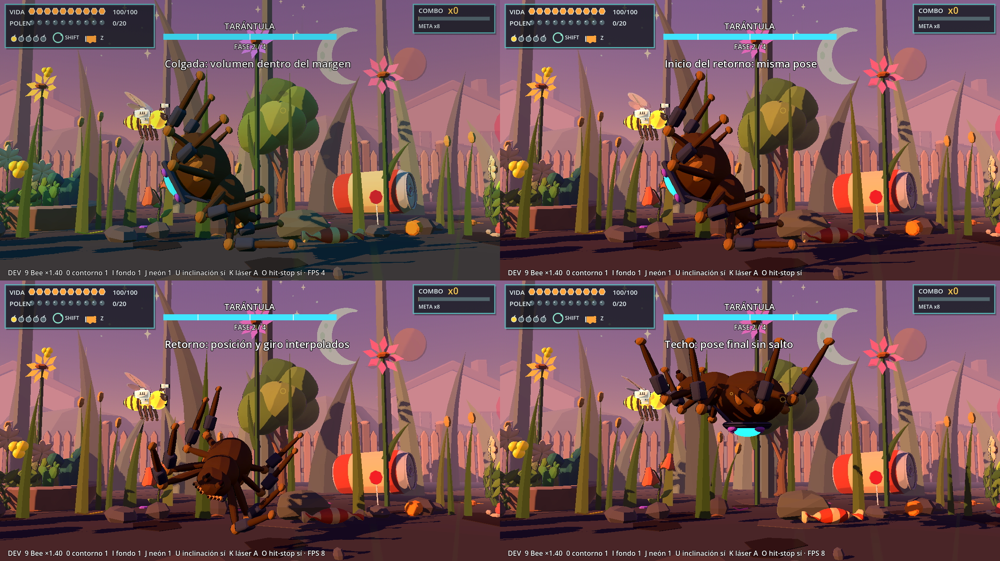
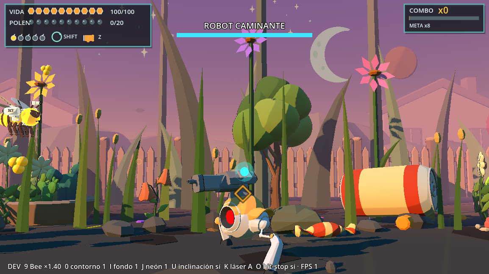
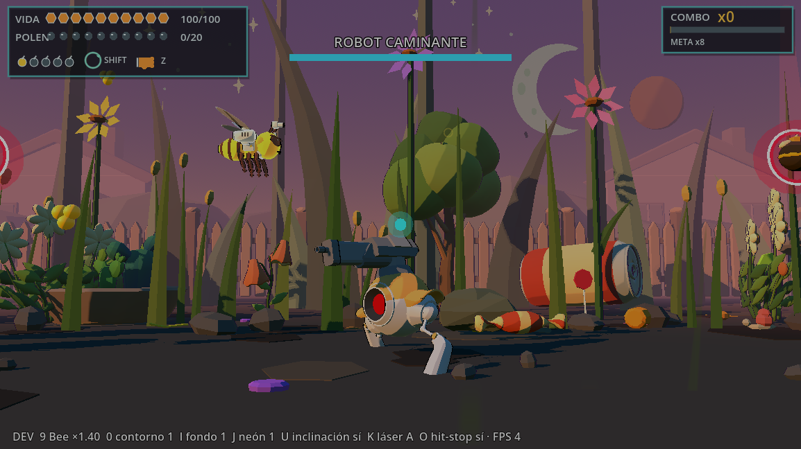

# T7b — Combo con jefes y ajustes de Robot y Tarántula

16/10/2026. Rama `lote-16-titulo-intro`, base `707b5a4`. Se leyó `INFORME_TANDA_7A.md` y se contrastaron sus hallazgos con el código vigente, que ya incluye Nova y Puñetazo. Esta tanda no implementa las propuestas nuevas de dificultad/refuerzos de T7a ni cambia vidas o daños de los jefes.

## 1. Combo y jefes

Había dos diferencias: Robot pasaba por la conexión de impactos de la fábrica y Tarántula no; además los impactos solo renovaban un combo positivo, sin iniciarlo desde cero. El descanso obligatorio de 5,5 s y la entrada de 3 s excedían la caducidad normal de 3 s.

Ahora **cada cambio negativo real de salud suma una unidad de combo**, igual en comunes, casco del Robot, cañón del Robot y Tarántula. No cuenta intentos bloqueados, balas falladas, curación ni impactos absorbidos sin daño. La conexión común `_connect_combo_health()` es idempotente. La baja/liberación conserva sus puntos, pero no suma otra unidad cuando ya contó su golpe final; las bajas comunicadas sin un golpe previo conservan el incremento existente. Los puntos siguen otorgándose al abatir/liberar, no por cada bala. Se elimina la notificación redundante de Nova, que ahora produciría dos incrementos por un mismo daño.

El reloj del combo se pausa durante entrada del Robot, descanso post-Robot, entrada de Tarántula y su transición obligatoria de fase. **No se reinicia ni se congela durante el combate normal**: al volver a una fase jugable se retoma el tiempo restante y puede vencer por inactividad. Así la cadena del Robot llega al primer tramo de la Tarántula sin depender de escoltas disponibles durante un interludio sin blancos. Derrota/reinicio no reciben una persistencia nueva.

Se conservan el umbral de frenesí x8, duración del beneficio, multiplicador de puntos y caducidad de 3 s. Como ahora los golpes hacen crecer la cadena, también alimentan ese umbral: es la consecuencia explícita de la nueva regla común. No se agregó un tope artificial x99 ni un sistema paralelo de combo de jefe.

Archivos: `bee_level_01_controller.gd`, `bee_level_01_juice.gd`. Prueba: `validate_bee_t7b_combo`: Robot y Tarántula desde cero, cañón, inmunidad, frenesí, puntos, golpe final sin duplicación, conservación en interludio/entrada y caducidad al reanudar combate.

## 2. Tarántula: margen en techo y colgada

El techo dejó de ser `top_y()+0,15`: ahora está **1,60 m dentro del borde superior**. Se reserva además **0,65 m de envolvente conservadora de pose**, porque las patas levantadas/animadas pueden superar la caja importada de reposo. Ambos valores son constantes del jefe.

`_keep_below_ceiling()` aplica la orientación actual a la envolvente visual y baja el root solo cuando techo/colgada/retorno lo requieren. No alcanza con limitar el pivote: se incluye el volumen girado del cuerpo y patas. Las áreas de combate se recolocan después de ese ajuste, conservando su tamaño y el plano Z de combate. Saltos, caminata de techo, pivote de cuerda y retorno toman la misma cota. El extremo de la cuerda se recalcula desde `ATTACH` después del ajuste para que siga unido al abdomen.

La primera revisión con render mostró que el AABB de reposo solo no reservaba suficiente espacio para las patas al volver al techo; se añadió la tolerancia de pose y se revisó la captura final. No se cambió la escala del modelo ni se lo dibuja por encima de paredes con `no_depth_test`.

Prueba: `validate_bee_t7b_ceiling`, ambas orientaciones, techo/colgada y tres extremos de oscilación; comprueba la envolvente bajo la cota segura y vértices dentro de cámara.

## 3. Tarántula: fin de colgada sin teletransporte

`_end_hang()` ya no asigna inmediatamente root de techo y giro PI. Guarda posición y basis iniciales, conserva esa primera pose y abre un estado de retorno. Durante los **0,45 s existentes de `HANG_UP`**, interpola posición con `smoothstep` y orientación con `Quaternion.slerp`. La pose de techo se fija al terminar, no al iniciar.

El retorno se inicia al acabar el balanceo y también al cancelar una colgada por cambio de fase. La transición puede seguir su reloj, pero no arranca otro ataque mientras se recoloca. La caja de ataque del péndulo permanece desactivada durante ese regreso. La cuerda sigue el abdomen hasta terminar y luego se libera. No se añade otro tramo de 0,45 s después del antiguo ascenso: se reutiliza esa ventana para el regreso completo.

Prueba: `validate_bee_t7b_return`, regreso normal y cancelación, primera pose idéntica, desplazamientos acotados entre muestras, llegada al techo y ausencia de reactivación de la caja del péndulo.

Secuencia con render, con el aviso temporal de fase oculto solo en la herramienta para leer los títulos:

## 4. Robot: margen inferior y revisión de la lata

Se verificó el recorte con el modelo real, no solo con el root Y=-0,2. Los AABB de las mallas FBX en bind pose daban una envolvente engañosa —en particular el mesh `Cylinder`, que pertenece al arma del Robot—, por lo que la verificación de pies usa **vértices transformados por skin, poses de huesos y pesos**.

Solo mientras está presente el Robot vivo, la cámara interpola en **0,65 s** hacia **10 % más de campo lineal** y **1 m menos de altura**: FOV 40° → **43,639°**, altura 2,45 → **1,45 m**. Borde inferior del plano Z=0: aproximadamente **-0,551 → -1,936 m**. Al terminar el Robot vuelve suavemente al encuadre normal. No se cambia el preset de otros niveles ni la posición/altura/hitboxes del actor.

`BeeLevel01Framing.effective_fov()/effective_height()` son la fuente compartida por cámara, bordes, spawns y límites de vuelo: no se modifica solo el dibujo dejando límites incoherentes. El estado transitorio se limpia al salir del nivel/cambiar preset. El nuevo límite de vuelo deriva del encuadre efectivo con los márgenes que ya existían.

La prueba toma cuatro tiempos de `CharacterArmature|Walk`, ambas orientaciones y agachado de 0,25 m. La menor separación inferior medida en su viewport headless de 64 px fue **7,885 px, 12,32 % del alto**, por encima del criterio mínimo de 3,5 %. La captura con render confirma pies completos en el agachado. La prueba no pretende que un AABB del FBX sin aplicar skin describa los pies animados.

**Lata revisada:** la de `AssetDressing` en **X=301**, visible al lado del Robot en el banco. Su extremo delantero ya estaba en Z≈-5,2 por el corredor de legibilidad; no era una capa 2D que se dibujara por encima del jefe. Se lleva solo esa entrada a `ROBOT_CAN_DEPTH=-10`, con el desplazamiento común de props grandes existente: su envolvente frontal queda detrás de Z=-8. Se reduce su tamaño aparente y ruido de suelo; no se borra ni se mueven las demás latas/regaderas. El `Cylinder` del FBX es el arma, no se oculta confundiéndolo con la lata.

Antes, Robot sin agacharse:

Después, Robot agachado 0,25 m y lata más al fondo:

Prueba: `validate_bee_t7b_robot_frame`; helper de verificación `tools/bee_boss_pose_probe.gd`. Render: `tools/jefes_t7b_review.gd`. Capturas Godot 4.7.2 Compatibility / Intel Arc B580, 1154×648. No se adjuntaron videos nuevos a este mensaje: se documenta la revisión reproducida en el proyecto, sin afirmar que se identificó un fotograma de un video ausente.

## 5. E73 / PrebossPower

**Se eligió mover el poder al evento, X=283**, no retrasar E73 hasta 334. Queda después del checkpoint 2 (X=281) y antes del Robot (X=294), por lo que realmente sirve como preparación para ese combate. Retrasar el evento hasta 334 lo dejaría después de la puerta del Robot y de parte del desplazamiento final.

La constante `BeeLevel01Controller.PREBOSS_POWER_X=283` se usa en el evento activo y al colocar `Powerups/PrebossPower`. La cápsula conserva Spread S+, sonido, pulso y reglas de recolección. El X=334 serializado de la escena se conserva **para el flujo legacy**; al sustituir pickups del roster del nivel 1 se aplica la posición 283. Esto evita alterar el contenido antiguo del UFO para resolver el evento del roster actual. No se reordena la tabla ni se desplazan las demás oleadas. El poder sigue delante del checkpoint para estar disponible al reintentar si no se recogió.

Prueba: `validate_bee_t7b_preboss`: compara la posición **real de la instancia**, el evento, la constante, su ubicación entre checkpoint/Robot y la identidad S+.

## 6. Pruebas y alcance de los fallos históricos

Antes de editar se ejecutaron siete relacionadas: **3 aprobadas y 4 ya fallidas**. Pasaron controles Lote 14, Puñetazo T4g y encuadre; fallaron `validate_bee_walker_miniboss_v01`, `validate_bee_tarantula_boss_v01`, `validate_bee_lote15_gameplay_v01` y `validate_bee_lote11_juice_v01`. Se conservaron sin reparar sus fixtures ni expectativas antiguas.

Validación dirigida de los cinco arreglos y regresiones cercanas: **13/13 aprobadas**. Cinco pruebas nuevas T7b, T4b, T4f, T4g, Nova T3m, controles Lote 14, encuadre, nube T6c y HUD Lote 17. La medición del Robot se corrigió para usar el nombre de clip con namespace mediante el helper `_play()` del propio actor; la validación final no usa el inexistente clip suelto `Walk`.

Se creó una prueba por tema. No se editaron los tests históricos existentes para volverlos verdes. Los logs de baseline, dirigidas y suite están en `dev/t7b_*`; los datos de capturas no se presentan como medición de FPS ni como un playtest humano.

### Resultado completo y pruebas que cambian

Una única pasada completa: **95/139 aprobadas y 44 fallidas**, **202,44 s**, sin timeouts. Comparación por nombre con el estado final de T4g: **ningún test existente cambia de aprobado a fallido ni viceversa**. No se modificó ningún archivo de test histórico. Los fallos de Robot/Tarántula conservan los errores de escena nula ya observados antes de editar.

La cifra de 45 citada en el pedido coincide con el resultado bruto de la pasada T4g, que también incluía la expectativa textual del HUD `AGUIJÓN Y / RB`. Esa expectativa ya se corrigió y revalidó en T4g: su estado final documentado era 44 fallos. T7b no arregla ninguno de esos casos ni repite esa corrección. El repositorio sigue sin estar completamente verde.

| Prueba que se agrega por T7b | Antes | Después |
|---|---|---|
| `validate_bee_t7b_combo` | No existía | Aprueba |
| `validate_bee_t7b_ceiling` | No existía | Aprueba |
| `validate_bee_t7b_return` | No existía | Aprueba |
| `validate_bee_t7b_robot_frame` | No existía | Aprueba |
| `validate_bee_t7b_preboss` | No existía | Aprueba |

Headless con hasta tres procesos aislados, APPDATA por prueba y 60 FPS fijos salvo las excepciones históricas de toon items/avispa. Se cerraron **27 procesos** tras SCRIPT ERROR persistente, contabilizados como fallidos, y hubo **0 timeouts**. Se inspeccionaron todos los resultados. No se repitió la suite completa. `git diff --check` sin errores. Los avisos de recursos al cerrar algunos procesos ya estaban presentes.

## 7. Cómo comprobarlo

F6 sobre `scenes/levels/bee_level_01_vertical_slice.tscn` en Godot 4.7.2. En X≈283 recoger el S+ junto al aviso de potencia. Al llegar al Robot, observar transición suave de cámara, pies durante marcha/agachado/salto y lata más al fondo. Disparar a casco/cañón: el combo debe crecer con daño real. Terminarlo y atravesar el interludio: conservar la cadena al entrar la Tarántula. Atacarla para seguir creciendo; dejar de pegar durante más de 3 s de combate normal para comprobar expiración.

En colgada, observar patas/cuerpo dentro del borde seguro y el regreso con giro progresivo, también si el daño provoca cambio de fase a mitad de péndulo. Z/Y/RB sigue siendo Puñetazo y Q/LT Nova, sin cambios de daño en esta tanda.

Para repetir el banco visual: Godot con `--path . --fixed-fps 60 --script res://tools/jefes_t7b_review.gd`, sin `--headless`. Escribe los PNG del informe. Las pruebas nuevas se ejecutan con `--headless --fixed-fps 60 --script res://tests/levels/validate_bee_t7b_<tema>.gd`.

Quedan pendientes la sensación con mando/mouse y la comprobación humana de videos/partida completa. Se dejan fuera del commit los cambios locales previos de `project.godot`, import de paleta de FlyCloud, documentos ajenos y UIDs/imports automáticos.

## Commits por tema

| Punto | Commit |
|---|---|
| Combo, impactos y continuidad entre jefes | `3c80697` |
| Margen de techo y colgada | `9942822` |
| Regreso interpolado | `cd31339` |
| Cámara inferior del Robot y lata | `7990768` |
| E73 / PrebossPower | `3a27bed` |

El commit de cierre lleva el mensaje solicitado `T7b: combo con jefes y ajustes de Robot y Tarántula` y agrega este informe, la herramienta de captura y las imágenes. Todos pertenecen al mismo push.
