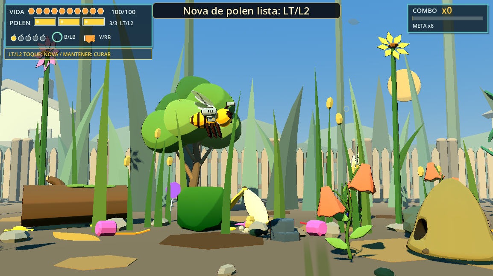
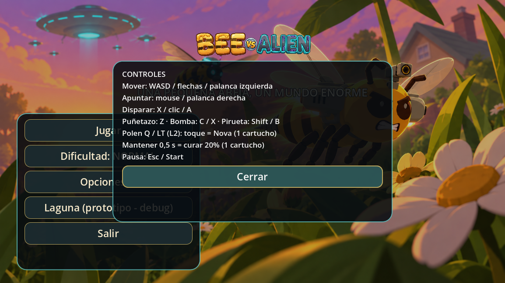

# Tanda A — Limpieza, combo, banners y polen en cartuchos

16/10/2026. Rama `lote-16-titulo-intro`; base `9e4ac34`. Cambios localizados sobre el nivel vigente. Se revisaron `CLAUDE.md`, el informe maestro y los informes T3m/T7b. Se conservaron los cambios ajenos previos en `project.godot` y en el importador de la textura de FlyCloud, y los archivos sin seguimiento que ya estaban presentes.

## 1. Neón y debug

El valor definitivo ya era `DEFAULT_NEON=1`; se conserva. La línea DEV arranca oculta. **F3 ya estaba asignada a `bee_hud_debug`**: se reutiliza esa misma bandera, sin agregar otro atajo. Las teclas 9/0/I/J y los comparadores U/K/O solo responden con F3 activo y en una compilación de desarrollo. Al cerrar debug se restablece neón 1. Los exports conservan los valores de presentación y no habilitan los comparadores.

Archivos: `bee_live_readability.gd` y su validación. No se modifican hitboxes ni parámetros de daño.

## 2. Cáscaras de banana

Auditoría de las dos rutas de creación del nivel: decoración `LITTER` en **X=63** y obstáculos `item_kind=4` en **X=120 y X=242**. Son tres instancias del mismo wrapper GLB; no se modificó el modelo ni su fuente.

Ambas rutas llaman al helper `bee_grounded_prop.gd`: inclinación configurable de **0,10 rad (~5,7°)** y apoyo del vértice más bajo transformado sobre **Y=-0,19**, la superficie del suelo visual (`GROUND_Y + 0,01`). Se usan los vértices reales, porque una caja AABB rotada puede dejar aire bajo una pieza irregular. Las bananas decorativas mantienen sus colisiones desactivadas.

## 3. Marcadores heredados de checkpoint

Se retiran estos nodos generados:

| Marcador | Ubicación | Motivo |
|---|---|---|
| `CheckpointBeacon/CheckpointRing` | X=190 | Aro toroidal antiguo, sin función en activación o respawn |
| `CheckpointBeacon2/CheckpointRing` | X=281 | Duplicado del aro, flotando sobre la flor |
| `CheckpointBeacon/CheckpointLabel` | X=190 | Rótulo 3D siempre oculto; el aviso usa HUD |
| `CheckpointBeacon2/CheckpointLabel` | X=281 | Duplicado oculto del mismo rótulo |

Se conserva la flor de checkpoint 2, el poste del primero, sus triggers por distancia, banners y snapshots. No se borran assets del repositorio. Se actualizan las pruebas que exigían el aro o buscaban los rótulos ocultos.

## 4. Flores altas del fondo

Los pétalos rosa, amarillo cálido y violeta ya usaban el shader toon de doble cara, pero quedaban expresamente excluidos del contorno. Ahora tienen un espesor procedural mínimo y caras de cierre para que funcione el mismo contorno de sólidos del resto de los props (`BeeToonStyle.OUTLINE_PROP`, nivel 1). Se conservan colores, posiciones, semillas y agrupación por material/chunk. Las otras variantes de pétalos amarillos/crema reciben también ese pase cuando se utilizan.

Archivo: `bee_level_01_visual_target.gd`. No se agregan nodos por pétalo ni assets externos.

## 5. Avisos de dispositivo

Solo una entrada efectiva cambia el dispositivo activo: botón presionado, tecla sin repetición, eje fuera de la zona muerta o movimiento de mouse de **8 px como mínimo por evento**. Soltar un botón, conectar un mando sin usarlo o mover mínimamente el mouse no dispara el aviso.

Los banners tienen **15 s mínimos entre apariciones**, se descartan si el carril de avisos está ocupado y no se encolan para después. Se bloquean en arenas, cuando hay enemigos activos, durante Robot y durante Tarántula; si empieza un combate mientras un aviso está visible, se oculta. El dispositivo activo y las pistas Q/LT-L2 sí se actualizan inmediatamente aunque el banner se descarte. Se conserva la duración visual de 2 s y el fade del sistema compartido.

Archivos: `bee_input_devices.gd` y `bee_hud_notices.gd`.

## 6. Combo

Cada baja o liberación suma **+1**; los impactos no letales a comunes solo renuevan la ventana vigente. El daño real a Robot, su cañón y Tarántula comparte un límite de **un incremento cada 0,5 s**. Se ignoran intentos bloqueados y se evita que casco y cañón cuenten dos veces dentro de esa ventana. La baja del jefe conserva su recompensa de baja, como cualquier enemigo.

Se mantienen ventana de **3 s**, reinicio, puntos de bajas y Frenesí en cada múltiplo de **x8**. Continúan las pausas del reloj durante entradas y descansos obligatorios implementadas en T7b. La prueba aplica **100 daños reales en 10 s a cada jefe: exactamente 20 incrementos**, y comprueba x8/x16, daño bloqueado y una sola unidad por baja común.

Archivos: controlador, Juice y `validate_bee_t7b_combo.gd` (contrato actualizado a esta tanda).

## 7. Tres cartuchos de polen

Fuente de parámetros: `bee_pollen_nova_settings.gd`. **7 granos por cartucho, 3 cartuchos, capacidad total 21**. Se elige 21 en lugar de 20 para que los tres segmentos tengan el mismo costo. El HUD muestra tres segmentos independientes con relleno parcial, grano, marco y contador de cartuchos. Se preservan imán, sonido y diseño del pickup T3m.

| Gesto Q / LT-L2 | Costo | Resultado |
|---|---|---|
| Toque, soltar antes de 0,5 s | 7 granos | Nova existente: radio 4 m, borra balas enemigas, daño 9 a comunes / 6 a jefes, invulnerabilidad 0,3 s |
| Mantener 0,5 s | 7 granos | Cura 20% de vida máxima (20 HP con máximo 100), brillo dorado circular alrededor de Bee durante 0,5 s |

Ambos comparten cooldown de **1 s**. El toque se resuelve al soltar para distinguirlo de la cura; mantener produce una sola cura y nunca una Nova adicional al soltar. Con salud completa, mantener no consume polen. La cura no agrega invulnerabilidad. Se conserva progreso parcial y los otros cartuchos; exceder la capacidad no guarda reservas ocultas. Llenar la barra no cura automáticamente.

La primera carga utilizable de la partida encola un banner grande de 3 s: **“Nova de polen lista: Q”** o **“Nova de polen lista: LT/L2”**, según el dispositivo activo incluso si cambia mientras está visible. Después queda el botón junto al medidor y la leyenda toque/mantener. La pantalla de controles y la ayuda de pausa explican ambos gestos; el panel de controles se amplía para acomodar la nueva fila.

Archivos: settings de Nova, Juice, HUD, título, ayuda de checkpoint y `bee_pollen_heal_glow.gd`. No se toca el daño del Puñetazo.

## 8. Validación

Base completa disponible de T7b: **139 pruebas, 95 aprobadas y 44 fallidas**. Antes de editar se repitieron las cuatro directamente afectadas (`validate_bee_t7b_combo`, `validate_bee_t3m_pollen_nova`, `validate_bee_t1b_hud`, `validate_bee_live_readability`): **4/4 aprobadas**. No se volvió a correr la suite completa antes de cambiar; se usó el resultado conservado de la tanda previa.

Pruebas dirigidas finales: **10/10 aprobadas** (cleanup, cartuchos, combo, live readability, T1b HUD, checkpoint lote17, polen lote14, Nova T3m, Puñetazo T4g y FlyCloud T6c). Se agregan `validate_bee_tanda_a_cleanup.gd` y `validate_bee_tanda_a_pollen.gd`; se ajustan las expectativas que esta tanda reemplaza explícitamente.

La suite completa se ejecutó **una sola vez**: **141 pruebas, 94 aprobadas y 47 fallidas**, en 225,83 s. Tres diferencias frente a la base fueron tests de comparadores (`validate_bee_t3k`, `validate_bee_t4e`, `validate_bee_t4f`) que todavía esperaban K/U/O activos con debug oculto. Se actualizaron únicamente sus fixtures para activar la misma bandera de F3 y se repitieron esas tres: **3/3 aprobadas**. No se modificó gameplay después de la corrida completa ni se repitió toda la suite.

Resultado consolidado de la corrida completa más esas repeticiones dirigidas: **97/141 aprobadas, 44 fallos previos, cero regresiones pendientes**. Se conserva el resultado bruto y el consolidado (`dev/tanda_a_final_results.json`) para distinguir ambos. Las expectativas nuevas de debug, cartuchos y aros reemplazan contratos anteriores de sus pruebas; no son arreglos de los 44 fallos históricos.

Fallos previos de la base, conservados sin intentar repararlos:

- `validate_alien_probe_visual`
- `validate_bee_arcade_combat_patterns_v02`
- `validate_bee_arcade_pressure_world_interaction_v01`
- `validate_bee_arcade_rebuild_v02`
- `validate_bee_asset_fauna_v01`
- `validate_bee_assets_cleanup_v02`
- `validate_bee_audio_basic_v01`
- `validate_bee_balance_liberation_v04`
- `validate_bee_boss_fight_v04`
- `validate_bee_checkpoint_qol_v01`
- `validate_bee_combat_poc`
- `validate_bee_combat_variety_v01`
- `validate_bee_combat_vfx_v01`
- `validate_bee_controlled_fauna_v01`
- `validate_bee_fauna_facing_v01`
- `validate_bee_flight_poc`
- `validate_bee_free_aim_v01`
- `validate_bee_garden_toad_v01`
- `validate_bee_items_shots_v04`
- `validate_bee_level01_arcade_director_v01`
- `validate_bee_level01_challenge_balance_v01`
- `validate_bee_level01_roster_v01`
- `validate_bee_level01_transformation_v01`
- `validate_bee_level_01_vertical_slice`
- `validate_bee_liberation_v01`
- `validate_bee_lote11_density_v01`
- `validate_bee_lote11_juice_v01`
- `validate_bee_lote13_combat_v01`
- `validate_bee_lote15_gameplay_v01`
- `validate_bee_mission_01`
- `validate_bee_pacing_v01`
- `validate_bee_readability_v03`
- `validate_bee_second_checkpoint_v01`
- `validate_bee_shmup_air_ground_poc`
- `validate_bee_shmup_ground_threat_poc`
- `validate_bee_shmup_organic_alien_poc`
- `validate_bee_tarantula_boss_v01`
- `validate_bee_threat_camera_boss_v03`
- `validate_bee_ufo_boss_01`
- `validate_bee_ufo_boss_nodo_v02`
- `validate_bee_ufo_overload_v01`
- `validate_bee_visual_polish_v02`
- `validate_bee_walker_miniboss_v01`
- `validate_wasp_visual`

Los logs y resultados de ejecución están en `dev/tanda_a_{before,related,full}_*` y `dev/tanda_a_*_results.json`. Se cuenta cualquier `SCRIPT ERROR` como fallo aunque el proceso devuelva 0. No se corrigieron los tests históricos ajenos a esta tanda.

Revisión con render Compatibility a 1154×648: HUD de teclado, HUD de mando y controles sin textos cortados. Las capturas se generaron en `dev/` y se copiaron al informe. No equivalen a un playtest completo del dueño.

## 9. Cómo probar

Abrir el proyecto y `scenes/levels/bee_level_01_vertical_slice.tscn` con F6, o iniciar desde el título. Al empezar no debe verse DEV. F3 abre/cierra debug; sin F3, 9/0/I/J no cambian la presentación. Revisar bananas en X63/120/242 y checkpoints X190/281. Las flores altas deben tener borde como los otros props.

Reunir 7 granos: aparece el aviso y se habilita un cartucho. Tocar Q/LT-L2 para Nova; con vida faltante, mantener 0,5 s para curar. Reunir hasta 21 para ver los tres segmentos completos. Alternar mando/teclado fuera de combate: se actualizan las pistas inmediatamente pero no hay avisos separados por menos de 15 s; durante combate no debe aparecer ninguno. Disparar sostenido a Robot/Tarántula y observar que el combo ya no suma por cada bala.

Entrega organizada en commits por neón/debug, bananas, aros, flores, banners, combo y cartuchos/informe. Una revisión posterior detectó finales de línea CRLF introducidos al preparar hunks en tres archivos compartidos; se normalizaron a LF en un commit adicional, sin cambios de lógica ni reescritura de commits. El último usa el mensaje solicitado por el dueño. Push a `origin/lote-16-titulo-intro`.
