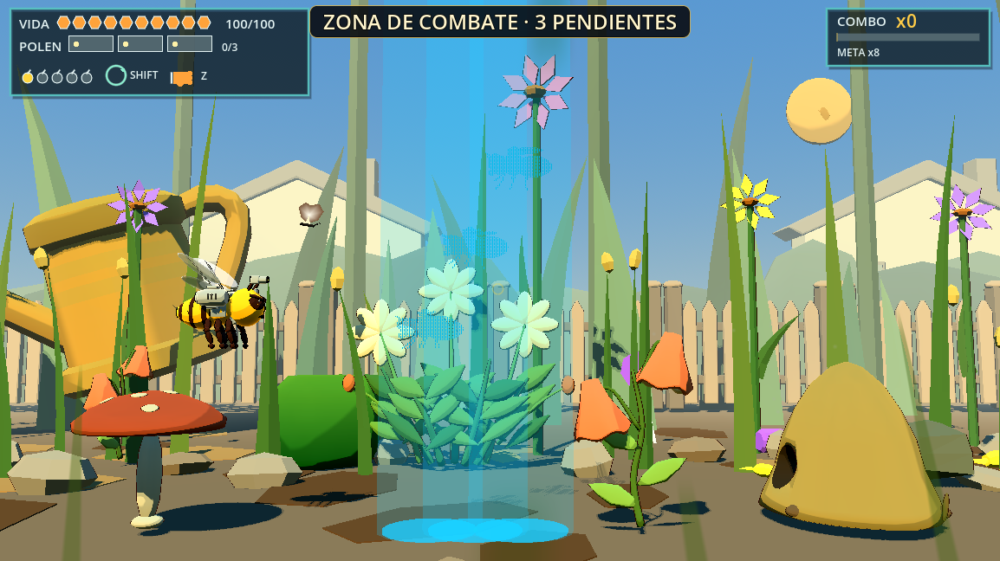
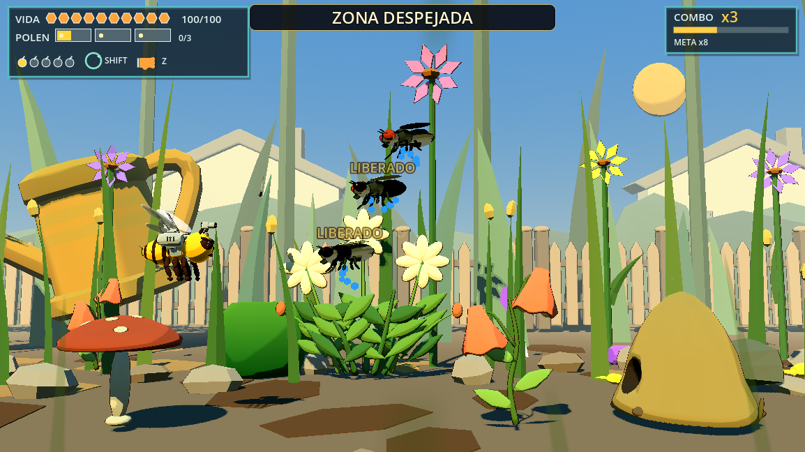
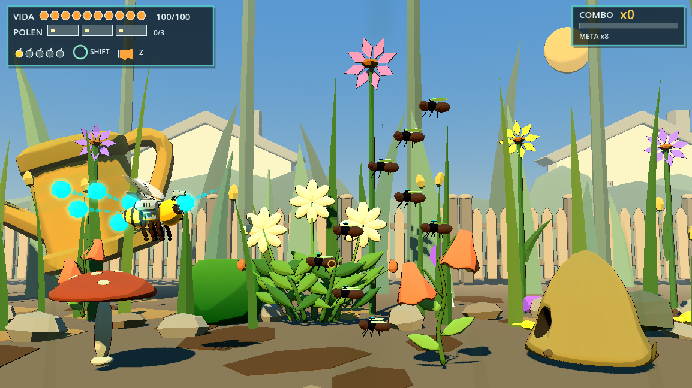

# Tanda B — T11a + T6d

16/10/2026. Rama `lote-16-titulo-intro`, base `8869174` (Tanda A). Se leyeron CLAUDE, informe maestro, Tanda A y T6c. Se conservaron los cambios previos ajenos en `project.godot`, la importación de paleta FlyCloud y todos los archivos sin seguimiento. No se cambiaron ramas, modelos, fuentes `.blend`, assets externos, daño de Bee ni jefes.

## Auditoría previa

- `bee_level_01_controller.gd::_retire_soft_units`: tras `CAMERA_TIME` (10–24 s según familia), o si un terrestre quedaba detrás del borde izquierdo, marcaba `level_retreat`, detenía IA/colisiones y desplazaba al actor a **10 m/s hacia la izquierda**. Al superar cámara X−8 lo quitaba de `active_units`, incrementaba `escaped_count` y hacía `queue_free`. Incluso un actor aún dentro de su tiempo se borraba si cruzaba X−8.
- `_debut_ready` forzaba `level_born=-1000` después de `DEBUT_CLEAR_MAX`, provocando esa retirada para despejar la presentación siguiente. `_spawn_swarm_pending` borraba los drones con `escaped`.
- Las zonas se declaran con `arena` en `EVENTS_ROSTER` (macizo, huerta y sombra; X138/214/262). `_begin_arena` usaba scroll de 0,3 m/s. `_update_arena` tenía cadencia de oleadas y permitía terminar por `arena_max_seconds`, incluso con supervivientes. No era una compuerta estricta.
- Wasp/AssetFauna/Dragonfly/Spider también tenían una salida por cantidad de ataques/pasadas. Aunque el director subía sus límites a 99, no garantizaban persistencia indefinida.
- Las columnas celestes con marca del evento `watering_can` en X128 eran `BeeLevel01WateringEvent`: tres tandas de dos columnas, aviso de 1 s y peligro de agua. **No tenían pasajeros ni materializaban enemigos**. Se convierten las llamadas de juego a llegadas reales; los helpers antiguos se conservan para fixtures aislados y no se invocan en el evento del nivel. Los morteros con charco y el láser de jefes siguen siendo ataques funcionales distintos.
- La nube previa T6c tenía 60 miembros (24 visibles y 36 de reserva), un administrador activo y MultiMesh opaco. Se reutiliza esa optimización y la geometría del GLB existente.

## Sin escapes, compuertas y rescate

No hay borrado, premio ni reinicio de vida al salir de pantalla. El director inicia un retorno por rayo cuando el actor cruza el borde izquierdo más 0,9 m; utiliza el mismo nodo y sus mismos HP. También recupera los drones que terminaron su trayectoria, reiniciando su pasada/aviso para evitar un bucle de teletransportes. Las salidas por cantidad de ataques se deshabilitan mediante `level_persistent` exclusivamente para actores creados por este director. El robot y los jefes mantienen sus entradas y arenas propias.

El retorno avisa **0,6 s**, con escala relativa **1,0–1,12** y pulso de brillo. Cancela el ataque comprometido y sus armas auxiliares antes de moverlo; no traslada una hitbox de ataque activa sobre Bee. La variante elegida es rayo de retorno, sin desplazamiento acelerado a la izquierda.

Cada zona fija **scroll=0**. Su contador persistente incluye vivos, miembros supervivientes de grupos, pedidos pendientes y las futuras oleadas obligatorias, con sus acompañantes. Los pedidos de zona no expiran. La última liberación/muerte real, después de todas las oleadas, muestra **ZONA DESPEJADA**, devuelve la velocidad de ruta y conserva el descanso existente. Se quitó la salida por timeout. La vía de presentación de especies tampoco fuerza retiros.

El contador usa el carril compartido `HUDNotices`, con prioridad sobre el nombre de especie/dispositivo; el rótulo Section se oculta para evitar textos superpuestos y se restablece al terminar el aviso de despeje. Se conserva en cola la indicación accionable de Nova lista.

Con **1–3 enemigos individuales** supervivientes y **más de 12 s sin acercarse**, se activa un retorno al sector alcanzable: X≈Bee+3 m, limitado al encuadre; los terrestres permanecen en el suelo. Acercarse al menos 0,25 m renueva el plazo; estar dentro de 4,5 m también. El conteo considera cada mosca viva, no solamente el administrador. Un retorno nunca elimina al actor del contador. Movimiento, reloj y efecto respetan pausa; un director congelado no activa llegadas tardías.

Parámetros: `scripts/game/bee_encounter_settings.gd`.

## Teletransporte real

Todas las llegadas ordinarias de la fábrica del nivel utilizan `bee_enemy_teleport.gd`:

1. Marca de suelo de **0,5 s** (0,6 en retorno).
2. Haz vertical en esa X y aparición del pasajero **dentro del haz**.
3. Materialización por **dither/discard de 4×4**, durante **0,45 s**, sin ALPHA en el material del pasajero; funciona en Compatibility. Se restauran los materiales originales.
4. Apagado del haz en **0,15 s** y activación de IA/objetivos/colisiones. Durante la secuencia el subárbol completo del pasajero queda inerte y su salud bloqueada.

La primera oleada ahora tiene **tres FlyCommon** con alturas 2,4/3,6/4,8 y entradas espaciadas 0/0,2/0,4 s. Sus acompañantes automáticos se deshabilitan para mantener la muestra en tres. Todas las zonas reciben rayos desde su oleada inicial y las siguientes. A los **30 s**, y cada 30 s posteriores mientras siga la zona, se agrega una llegada sin acompañantes cuando hay presupuesto y no existe cola; con el presupuesto ocupado se trae por rayo a un superviviente. No se acumula una cola infinita de refuerzos. El evento celeste viejo de X128 entrega seis FlyCommon reales a través de la misma cola/capacidad.

Las entradas escénicas del robot, jefes y escoltas lanzadas por jefes conservan su ruta propia. Las hormigas ordinarias ahora materializan en suelo; los hormigueros y sus assets se conservan.





## Grupos de moscas

FlyCloud mantiene su identificador interno para no rehacer tablas/escenas/modelos, pero se presenta como **GRUPO DE MOSCAS**. Base **3** (tabla `COMMON_HP`, cuenta población) y desde X240 **5**. **Máximo dos grupos**, incluyendo los que se materializan. Los pedidos adicionales esperan en la cola; no se crean grupos extra ni reserva invisible.

Cada miembro conserva blanco/hurtbox individual y **1 HP**: un perdigón de un daño basta. Una bomba libera los miembros alcanzados. La recompensa agregada de grupo continúa una sola vez al completarlo, como en T6c. La formación es una V con posiciones definidas y dos carriles de grupo para separarlos. Cada **3,75 s todos los supervivientes disparan en el mismo callback** una bolita dirigida a Bee. Cada **6 s** dos moscas se desprenden, avisan **0,5 s** con escala 1,0–1,12 y pulso propio, pican y regresan; no hay líneas ni franjas. Se conserva el token de patrones pesados: si otro atacante lo ocupa, el grupo reintenta, por lo que seis segundos es la cadencia disponible, no una garantía de simultanear ataques pesados.

Se mantienen el MultiMesh compartido, materiales opacos y sombras desactivadas. Un administrador de movimiento por grupo; los descriptores pasivos de daño no ejecutan callbacks de movimiento. El censo de cinco moscas registra **34 nodos, 1 callback de script activo, 10 áreas, 1 MultiMesh, 0 luces, 0 AnimationPlayer, 0 mallas con sombra y 0 superficies transparentes**. El rayo transitorio sí tiene transparencia; no forma parte del material de las moscas.



## FPS antes y después

Banco con render real, **Godot 4.7.2 / Compatibility / OpenGL 3.3**, Intel **Arc B580**, driver **32.0.101.9150**, **1154×648**, VSync/tope apagados, mismo jardín/cámara en X138, Bee protegida y director detenido. Tres muestras de 5 s tras 3 s de calentamiento. Las moscas/ataques siguen activos. No se ejecutaron otros bancos Godot simultáneamente.

| Caso | FPS por muestra | Media | Mínimo por ventana de 1 s | Peor P99 de frame |
|---|---|---:|---:|---:|
| Antes: dos nubes T6c, 120 totales / 48 visibles | 180,09 / 178,11 / 178,51 | **178,90** | **176,75** | 6,816 ms |
| Después: dos grupos reales de fábrica, 10 visibles / sin reserva, con descargas y picadas | 159,06 / 187,15 / 168,47 | **171,56** | **116,13** | 8,773 ms |

**Meta ≥85 FPS alcanzada en este banco.** No se atribuye una mejora de FPS: esta pasada posterior resulta un 4,1 % inferior en media, con las nuevas descargas simultáneas activas; el coste del jardín domina ambas mediciones. La simplificación elimina la reserva y reduce miembros/áreas por grupo, pero no promete una mejora global sin medirla. Tampoco certifica cada frame o la resolución del dueño. Logs/JSON originales: `dev/tanda_b_benchmark_before.json`, `dev/tanda_b_benchmark_after_groups.json` y `dev/tanda_b_{before,after}_benchmark.log`.

Banco reproducible final: `tools/fly_group_benchmark.gd` (dos grupos de cinco de la fábrica, cámara/fondo iguales al control). Rechaza ejecución headless. Capturas de secuencia: `tools/bee_tanda_b_review.gd`, que guarda PNG en `dev/`.

## Validación

Pruebas dirigidas: **17/17 aprobadas**, más la repetición dirigida de integración tras añadir recuperación de drones. `validate_bee_tanda_b` comprueba primera oleada, marca/haz, materialización inerte, pausa, regreso sin borrado ni HP extra, aviso relativo, rescate a 12 s, contador, bloqueo más allá del antiguo timeout, liberación final, llegada terrestre, refuerzo a 30 s y **las tres zonas de la tabla real completas**, consumiendo todas sus oleadas mediante las señales de salud/liberación. También comprueba que un dron con ataque vencido vuelve con un aviso nuevo.

`validate_bee_t6c_cloud` reemplaza el contrato anterior 60/24/36 por T6d: 3/5 miembros, cero reserva, un solo callback, materiales opacos sin sombras, descarga conjunta, aviso/picada/retorno, perdigón físico de un daño, bomba y máximo de dos grupos. Las verificaciones de daño/armas/araña/patrones existentes se conservan; sus fixtures completan la llegada antes de aislar el combate. La prueba de hormiga cambia la expectativa de salida de hormiguero por llegada real en suelo; la araña persistente ya no debe retirarse tras dos ataques.

Una única pasada completa final: **98/142 aprobadas, 44 fallidas**, en **199,78 s**. Los 44 nombres fallidos son exactamente los mismos de la base consolidada de Tanda A (`dev/tanda_a_final_results.json`, 97/141); **cero regresiones nuevas y ningún fallo histórico reparado**. La nueva validación de Tanda B suma una aprobación. No se repitió la suite completa. Resultados/logs: `dev/tanda_b_full_results.json` y `dev/tanda_b_full_*.log`; las pruebas dirigidas están en `dev/tanda_b_final_related_results.json` y `dev/tanda_b_last_delta_results.json`.

La lista histórica completa se conserva en [INFORME_TANDA_A.md](INFORME_TANDA_A.md). La comparación del runner con el resultado bruto de Tanda A muestra tres tests ahora aprobados (T3k/T4e/T4f), pero **ya estaban reparados y aprobados en su consolidado**; no se atribuyen a esta tanda. Se compara el conjunto de fallos contra ese consolidado. La suite del repositorio sigue sin estar completamente verde.

## Archivos y alcance

Producción: director N1, nuevo efecto/configuración de encuentros, administrador/configuración/tabla de población de moscas, bandera de persistencia en AssetFauna/avispa/araña/libélula, conversión del evento celeste y prioridad del banner compartido. Tests: integración nueva, contrato T6d y fixtures afectados por llegada diferida. Herramientas: banco GPU y captura de secuencia. Informe y tres capturas en docs.

Se preservan fuentes y GLB. No se incluyen cambios previos ajenos ni imports/UIDs automáticos de otras tandas. Los avisos de recursos al salir de algunos tests headless ya existían; un SCRIPT ERROR se considera fallo aunque el proceso retorne 0.

## Cómo probar

Abrir `D:\proyectos\bee_alien_3d`, escena `scenes/levels/bee_level_01_vertical_slice.tscn`, **F6**. Disparar con X/clic, moverse con WASD y usar Shift para esquivar. Al empezar observar tres marcas y sus pasajeros apareciendo dentro del haz. Dejar enemigos pasar por la izquierda: deben regresar por rayo con aviso, conservando HP. En X138/214/262 la cámara debe detenerse, el contador debe seguir visible y decrecer al liberar; la última baja muestra ZONA DESPEJADA y permite avanzar. En las zonas largas observar llegadas nuevas a los 30 s. Dejar 1–3 enemigos lejos durante más de 12 s sin acercarse: deben regresar a alcance. Desde X138 los grupos tienen tres moscas; desde X240 pueden tener cinco. Nunca más de dos. Observar la descarga conjunta, dos picadas con pulso y su retorno, y liberar cada mosca con un impacto.

Ejemplos PowerShell, desde el proyecto:

```powershell
$godot = 'C:\Users\rea_0\Downloads\Godot_v4.7.2-stable_win64.exe\Godot_v4.7.2-stable_win64_console.exe'
& $godot --headless --fixed-fps 60 --path . --script res://tests/levels/validate_bee_tanda_b.gd
& $godot --headless --fixed-fps 60 --path . --script res://tests/levels/validate_bee_t6c_cloud.gd
& $godot --path . --resolution 1154x648 --script res://tools/fly_group_benchmark.gd
& $godot --path . --resolution 1154x648 --script res://tools/bee_tanda_b_review.gd
```

Entrega solicitada en `lote-16-titulo-intro`, con mensaje **Tanda B: sin escapes, compuertas, teletransporte y grupos de moscas**. El hash y el resultado del push se informan en la entrega. Los 44 fallos históricos se declaran expresamente; las validaciones relacionadas y el caso nuevo están aprobados.
