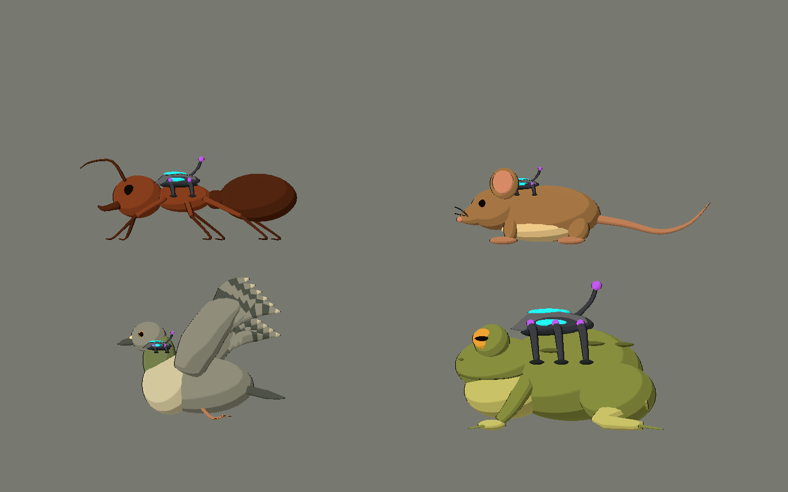
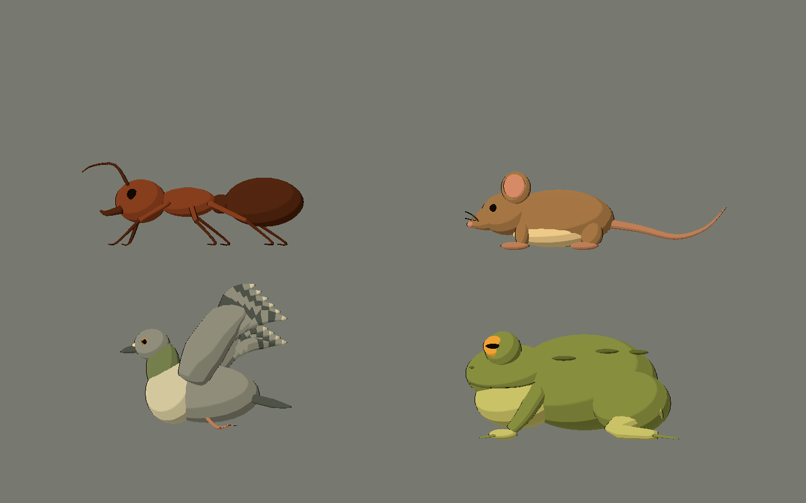

# Bee Alien — familia canónica de implantes externos

2026-10-10. Referencia original de construcción para nuevos enemigos y para una
futura unificación visual del Nivel 01. No sustituye automáticamente sus enemigos
ni su jefe actual. El jefe actual es un OVNI; el anfibio de esta hoja es un estudio
original para el futuro mini-jefe del lago.

## Identidad común

- Carcasa grafito redondeada, dos aletas cortas en horquilla y base acolchada.
- Una lente cian principal y ventanas laterales cian: se leen desde cámara lateral.
- Bisagras violetas y un receptor posterior corto; energía secundaria de menor tamaño.
- Abrazaderas externas con almohadillas anchas. Sin perforaciones, cables orgánicos ni mutación.
- Toda tecnología, incluidos blindajes y cargadores, pertenece a `AlienControlDevice`.
- La anatomía completa queda en `NaturalFauna`. Liberar oculta sólo el dispositivo.

| Material | Color fuente sRGB | Uso |
|---|---|---|
| Shell | (0,19; 0,21; 0,26) | Carcasa principal |
| ShellEdge | (0,32; 0,34; 0,39) | Aletas y borde |
| Rubber | (0,12; 0,14; 0,16) | Base y contacto |
| Cyan | (0,10; 0,78; 0,85) | Lente activa y boca de cañón |
| Violet | (0,59; 0,27; 0,84) | Bisagras y receptor |

Los colores se convierten a lineal al generar Blender. Las escenas de Godot
aplican toon, contorno y emisión limitada a 0,65 para mantener el color en
Compatibility sin bloom. La naturaleza conserva su paleta y no emite cian/violeta.

## Cuatro monturas, una familia

| Montura | Aplicación | Ajuste |
|---|---|---|
| `Mount_insect` | Hormiga, oruga, libélula, polilla | Cuatro abrazaderas compactas; proteger tórax sin confundirlas con patas naturales. |
| `Mount_mammal` | Ratón de V04 en la hoja | Base más ancha, sujeción sobre el lomo; no cubrir orejas, cara o cola. |
| `Mount_bird` | Paloma de V04 en la hoja | Perfil corto junto a nuca/hombro; dejar libres articulaciones de alas. |
| `Mount_amphibian` | Estudio original de sapo | Seis puntos de sujeción, carcasa ampliada y almohadillas sobre el dorso. |

La hoja utiliza el ratón y la paloma propios de V04; sólo sus instancias de
galería reciben monturas nuevas. Sus archivos originales se conservan.

## Archivos y reutilización

- Fuente editable: `art_source/blender/shared/alien_tech/canonical_implant_kit.blend`.
- Intercambio: `assets/models/shared/alien_tech/canonical_implant_kit.glb`.
- Escena con toon: `scenes/art_labs/assets_v09/canonical_implant_kit.tscn`.
- Hoja y revisión: `scenes/art_labs/future_biomes_v09.tscn`, página **C**.
- Constructor común: `implant()` en `tools/art/create_future_biomes_v09.py`.

El kit presenta las cuatro monturas distribuidas para compararlas. Para usar
una, conservar sólo su nodo `Mount_*`, reiniciar su transformación de composición
y ubicarlo sobre el anfitrión. Renombrar su dispositivo a `AlienControlDevice`
cuando se use `future_asset_visual.gd`. Las escenas de enemigo ya están preparadas.

Cada montura incluye `DamageTarget` junto a la lente. Es un punto de referencia,
todavía sin hurtbox. Definir collider, vida y liberación en el POC de combate;
la salud debe representar el dispositivo. No sustituir la anatomía por una
explosión del animal ni suponer que ocultar el implante desactiva el gameplay.

Los grupos del kit mantienen nombres semánticos, pero sus mallas se agrupan
por dispositivo para reducir superficies. Editar geometría en Blender si se
necesitan abrazaderas articuladas. Los contactos deben reajustarse al animar o
cambiar la escala de cada anfitrión.

## Verificación

V09: 0 fallos, cuatro anfitriones en la hoja y liberación que conserva toda la
anatomía. La hoja limpia no contiene texto, interfaz, logos ni entorno. V10
reutiliza el mismo constructor en los nuevos enemigos. Ver los informes V09/V10
para inventario, capturas y límites de integración.
