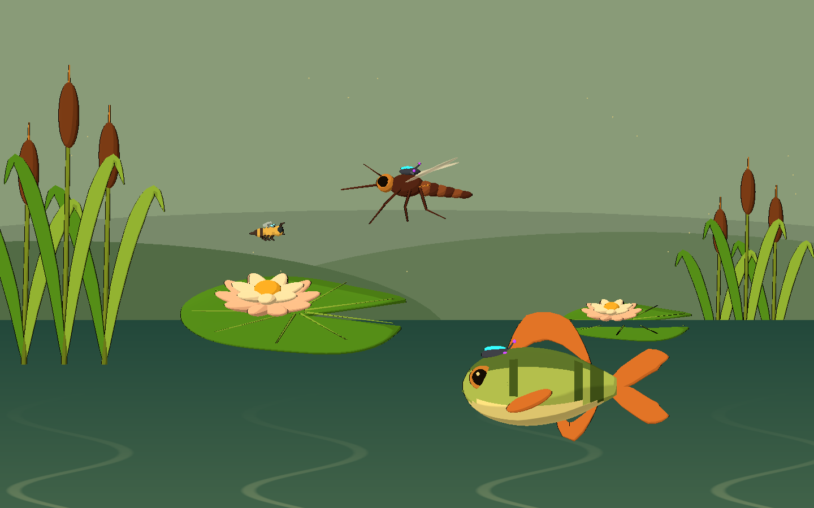
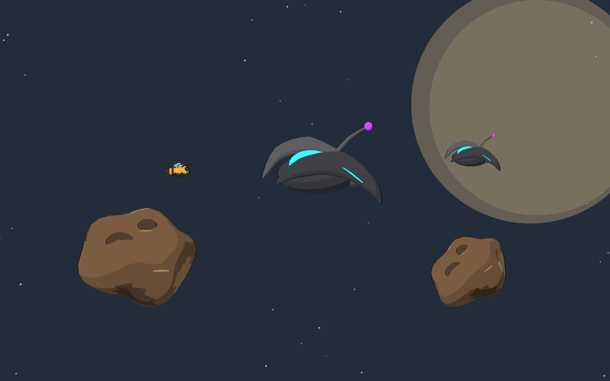
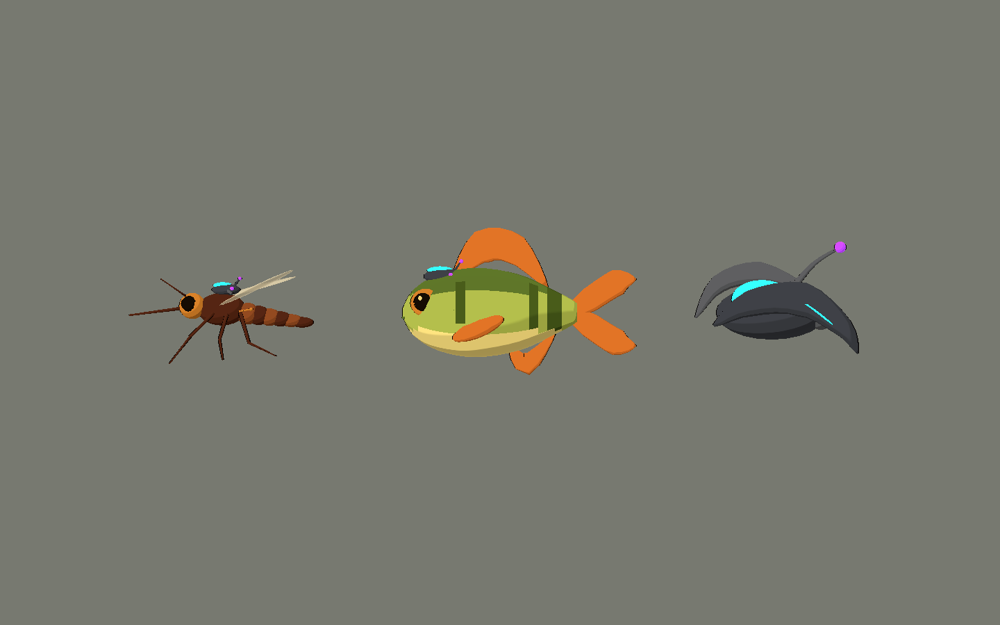

# Primera tanda de arte para biomas futuros

2026-10-10. Seis modelos originales, seis fuentes Blender, escenas reutilizables,
shader de agua y HUD visual. Galería aislada para Godot 4.x / Compatibility.

## Ver y probar

Abrir `scenes/art_labs/future_biomes_v01.tscn` en Godot y ejecutar la escena con **F6**.

- **1 / 2 / 3** o botones: lago, espacio, estudio.
- **Flechas**: cambiar vista.
- **4–9** o menú «Ver una pieza»: inspeccionar cada modelo individualmente.
- **V**: alternar vista lateral y 3⁄4 de la pieza seleccionada.
- **L**: poner/quitar los dispositivos de mosquito y pez. El animal permanece intacto.
- **H**: ocultar toda la interfaz. La vista de estudio queda sin texto, UI ni entorno.
- **P**: pausar la oscilación suave de las piezas flotantes. El agua sigue animándose.

La abeja existente se muestra como referencia de escala en las composiciones de lago y espacio.





## Inventario

| ID / archivo | Diseño y uso propuesto | Triángulos de la fuente | Mallas |
|---|---|---:|---:|
| `controlled_mosquito` | Mosquito marrón/ocre, seis patas, probóscide, dos alas y halterios. Receptor dorsal externo. Enjambre aéreo del lago. | 7.840 | 39 |
| `controlled_perch` | Perca oliva con vientre crema, rayas naturales, aletas cálidas. Receptor externo delante de la aleta dorsal. Amenaza bajo la superficie. | 8.236 | 24 |
| `orbital_skimmer` | Interceptor con carcasa grafito, aletas curvas, lente cian y receptores violetas. Tecnología alienígena independiente. | 5.548 | 15 |
| `lotus_lily_pad` | Nenúfar con escotadura real, nervaduras y flor cálida. Pieza modular de superficie. | 7.632 | 28 |
| `cattails_cluster` | Tres totoras de alturas distintas y hojas curvas. Marco vertical de orilla. | 4.272 | 15 |
| `warm_asteroid` | Roca seca marrón/ocre con depresiones someras. Obstáculo o fondo espacial sin emisión. | 3.752 | 7 |

El manifiesto reproducible está en `assets/models/future_biomes_v01/manifest.json`.
Los recuentos corresponden a la geometría fuente triangulada; Godot puede generar LODs al importar.
Estas piezas conservan subobjetos editables. Para enjambres numerosos se deberá reducir el
número de superficies/draw calls después de aprobar los diseños.

## Archivos nuevos

- `art_source/blender/future_biomes_v01/{ID}.blend`: las seis fuentes; `.gdignore` evita una segunda importación automática.
- `assets/models/future_biomes_v01/{ID}.glb` y sus `.import`: seis exportaciones; `manifest.json` registra medidas y recuentos.
- `scenes/art_labs/assets/{ID}.tscn`: seis instancias listas para arrastrar a una escena.
- `scenes/art_labs/future_biomes_v01.tscn`: galería de tres vistas.
- `scripts/art/future_asset_visual.gd`: Style C, orientación y dispositivo removible; funciona también en el editor.
- `scripts/art/future_biomes_lab.gd`: composiciones y controles de galería.
- `scenes/ui/future_health_bar.tscn`, `scripts/ui/future_health_bar.gd`: barra reutilizable, variante miel y variante dispositivo alienígena.
- `assets/style/future_lake_water.gdshader`: agua opaca estilizada sin screen texture, válida en Compatibility.
- `tools/art/create_future_biomes_v01.py`: reconstrucción de los seis `.blend` y `.glb` originales.
- `tools/art/capture_future_biomes_v01.gd`: captura real del viewport.
- `tests/art/validate_future_biomes_v01.gd`: validación de importación, separación de fauna, materiales y HUD.
- `docs/art/STYLE_BIBLE.md`, este informe y `docs/art/future_biomes_v01/*.png`: biblia persistida y 19 capturas.
- Los `.gd.uid` generados por Godot acompañan a los scripts nuevos.

No se modificó la escena principal ni el código de combate existente. No se incorporó ninguna biblioteca externa.

## Usar los assets

Instanciar las escenas de `scenes/art_labs/assets`, que aplican el toon existente,
el contorno y el rim. Los GLB solos conservan sus materiales PBR de intercambio;
el estilo final se ve en sus escenas Godot.

Convención común: **X/Y = plano de juego; +Y = arriba; -X = frente**.
`face_right(true)` gira la visual hacia +X. La fuente Blender usa Z vertical y
la exportación GLB convierte a Y vertical. Origen en el cuerpo de los actores;
en la base de las totoras; en el centro de nenúfar y roca.

Para liberar un animal: `visual.release_control()` o `visual.controlled = false`.
El nodo `AlienControlDevice` contiene toda la tecnología; `NaturalFauna` conserva
la geometría biológica. También se puede separar ese nodo en Blender para una
futura animación de desprendimiento. Esta tanda no conecta daño ni estados de IA.

Instanciar `scenes/ui/future_health_bar.tscn` y llamar `set_health(current, maximum)`.
El valor se limita a 0–1 y un máximo cero deja la barra vacía.
`alien_device = true` usa cian/violeta y representa salud del **dispositivo**, no del animal.
La variante de Bee usa miel/ocre. No se reemplazó el HUD del nivel 01.

El agua se aplica a un `QuadMesh` orientado hacia cámara. Es una banda visual opaca
con reflejos cálidos desplazados por seno. No simula refracción, flotación ni nado.

## Comprobaciones realizadas

Blender 5.2.1: seis fuentes guardadas y seis exportaciones GLB completas.
Godot 4.7.2 con GL Compatibility / OpenGL 3.3 en Intel Arc B580:

- Importación y ejecución de las tres páginas de galería.
- Validador: **0 fallos**.
- Dispositivos externos ocultables y restaurables, sin afectar al animal.
- Emisión limitada a nodos de tecnología alienígena; nada de emisión cian/violeta en naturaleza.
- Giros de orientación y límites de salud, incluido máximo cero.
- **19 capturas** reales: dos galerías con UI, dos composiciones limpias, un estudio,
  doce vistas individuales lateral/3⁄4 y dos animales liberados.
- Inspección visual y corrección de normales, curvas y color exportado antes de la entrega.

```powershell
# Reconstruir (sobrescribe sólo esta tanda)
& 'C:\Program Files\Blender Foundation\Blender 5.2\blender.exe' --background --python tools/art/create_future_biomes_v01.py

# Importar, validar y capturar con el Godot instalado
$beeGodot = 'C:\Users\rea_0\Downloads\Godot_v4.7.2-stable_win64.exe\Godot_v4.7.2-stable_win64_console.exe'
& $beeGodot --headless --path . --editor --import --quit
& $beeGodot --headless --path . --script tests/art/validate_future_biomes_v01.gd
& $beeGodot --path . --resolution 1440x900 --script tools/art/capture_future_biomes_v01.gd
```

## Estado y límites

Son **POCs visuales** utilizables como decoración o visual de actores. No tienen
esqueleto, clips de animación, colisiones, hurtboxes, ataques ni navegación.
El pez propone una futura amenaza de agua; no agrega un sistema de nado al juego.
Las composiciones son estudios de ambiente, no niveles jugables terminados.

Compatibility mantiene las lentes de color luminoso, sin bloom HDR. El wrapper
reduce la energía de emisión en copias propias para evitar el blanco quemado;
no altera el caché de estilo compartido del juego.

El entorno de ejecución restringido emitió avisos al guardar miniaturas de Blender,
configuración/caché de usuario de Godot y recursos del editor al cerrarse. No impidieron
guardar `.blend`/GLB, ejecutar la galería, validar ni capturar. Los logs están en
`dev/future_biomes_*.log`; las ejecuciones de runtime no reportaron errores de script o shader.

## Próximas tandas pequeñas propuestas

Estas propuestas quedan documentadas; no se generaron assets adicionales.

| Bioma | Fauna / tecnología | Entorno |
|---|---|---|
| Bosque | Escarabajo ciervo con arnés removible; caracol natural | Helecho, corteza, bellota gigante |
| Residencial | Mosca o polilla controlada | Tornillo, tapa de botella, maceta, borde de ventana |
| Aire | Ave con receptor dorsal removible | Rama alta, semilla en vuelo, nubes suaves |
| Mar | Camarón con abrazadera externa | Concha, alga, roca costera; paleta natural marina |
| Zoológico | Tortuga o loro con dispositivo externo | Bebedero, barrotes y piezas de recinto a escala enorme |

Priorizar un animal y dos props por tanda, aprobar la silueta lateral y luego preparar
rig, animación e integración de combate. Mantener la biblia en `STYLE_BIBLE.md`.
