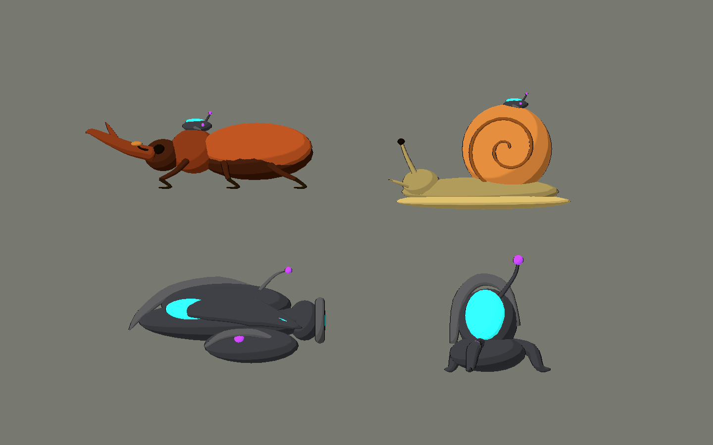
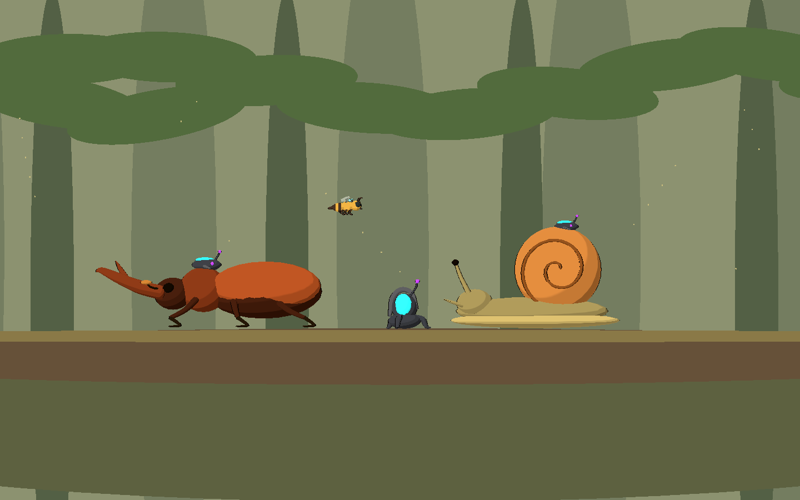
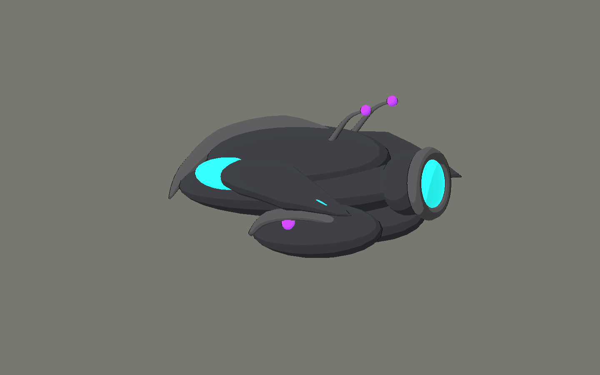

# Bee Alien — segunda tanda de arte

2026-10-10. Cuatro modelos originales para bosque y tecnología alienígena, con
fuentes Blender y GLB. Mantienen los mismos shaders Style C, cámara lateral,
contorno fino y luz de borde que la tanda anterior. Renderer Compatibility.

## Probar

Abrir `scenes/art_labs/future_biomes_v02.tscn` y ejecutar con **F6**.

- **F / O / E**: bosque, tecnología y estudio.
- **1–4** o menú «Ver una pieza»: inspeccionar cada modelo individualmente.
- **V**: alternar lateral y 3⁄4 de la pieza seleccionada.
- **L**: poner/quitar los receptores externos de la fauna.
- **H**: ocultar la interfaz para obtener una ficha sin texto ni UI.
- **P**: pausar la oscilación de las naves de la galería.
- **Flechas**: cambiar vista.

Las fichas individuales y el estudio limpio tienen fondo neutro, sin entorno,
texto, logos ni interfaz. Las composiciones de bosque/tecnología son vistas
contextuales independientes de esas fichas.





## Diseños

| Modelo | Diseño y papel futuro propuesto | Triángulos fuente | Mallas |
|---|---|---:|---:|
| `controlled_stag_beetle` | Escarabajo ciervo castaño, dos élitros, seis patas y dos mandíbulas ramificadas. Receptor externo sobre el tórax. Amenaza terrestre resistente; liberar al destruir el receptor. | 9.952 | 37 |
| `controlled_woodland_snail` | Caracol ocre, cuerpo natural, caparazón con espiral y dos tentáculos oculares. Abrazadera externa encima del caparazón. Amenaza lenta o cobertura móvil. | 7.748 | 19 |
| `alien_seed_carrier` | Nave de carga grafito, alas curvas, dos módulos inferiores separados, visor cian y pequeños receptores violetas. Transporte/invocador de dispositivos, distinto del interceptor V01. | 9.108 | 22 |
| `alien_signal_relay` | Repetidor portátil con núcleo cian protegido, antenas violetas y tres abrazaderas en un grupo independiente. Objetivo de sabotaje o prop de control. | 4.520 | 14 |

Los roles son propuestas de diseño; esta tanda no implementa sus ataques ni IA.
Las medidas, rutas y recuentos exactos están en `assets/models/future_biomes_v02/manifest.json`.

El escenario de bosque se compone en la galería de masas simples de árboles,
hojas y terreno para verificar escala y contraste. Es decoración del laboratorio,
no un pack de árboles exportado. La abeja y el interceptor pequeño se reutilizan
del propio proyecto para comparar escala y familia visual.

## Archivos agregados

- `art_source/blender/future_biomes_v02/{ID}.blend`: cuatro fuentes editables.
- `art_source/blender/future_biomes_v02/.gdignore`: evita importar Blender además del GLB.
- `assets/models/future_biomes_v02/{ID}.glb`, `.import` y `manifest.json`: cuatro modelos y sus datos.
- `scenes/art_labs/assets_v02/{ID}.tscn`: cuatro escenas reutilizables con toon aplicado.
- `scenes/art_labs/future_biomes_v02.tscn`: laboratorio aislado.
- `scripts/art/future_biomes_lab_v02.gd`: vistas y controles. Reutiliza los helpers del laboratorio V01.
- `tools/art/create_future_biomes_v02.py`: construcción reproducible de las fuentes y exportaciones.
- `tools/art/capture_future_biomes_v02.gd`: capturas del viewport real de Godot.
- `tests/art/validate_future_biomes_v02.gd`: comprobaciones de importación, estilo y separación de piezas.
- Este informe y `docs/art/future_biomes_v02/*.png`: 16 capturas.
- Godot agrega los `.gd.uid` de los scripts nuevos y los `.png.import` de las capturas.

No se editó la tanda V01, la biblia, los shaders compartidos ni las escenas de juego.
No se modificaron los otros proyectos ni se importaron assets de la biblioteca externa.

## Integración

Arrastrar las escenas de `scenes/art_labs/assets_v02` a la escena deseada. Aplican
`scripts/art/future_asset_visual.gd`, igual que V01, también en el editor. Los GLB
conservan colores PBR para intercambio; el cel shading final lo aplica Godot.

Convención: **-X = frente; +Y = arriba; X/Y = plano del juego**. Blender usa Z
vertical y exporta a Y vertical. `face_right(true)` gira hacia +X.

Los animales tienen origen cerca de la base de apoyo. La nave tiene origen en
el centro del casco. El repetidor tiene origen en el centro de su base.
La geometría se modeló en unidades métricas; ajustar escala por instancia según Bee.

Para liberar fauna, llamar `release_control()` o asignar `controlled = false`.
Toda la tecnología está en `AlienControlDevice`, separada de `NaturalFauna`.
Ocultar ese nodo deja la anatomía completa y no cambia el color del animal.

En el repetidor, `MountingClamps` reúne las tres abrazaderas. Puede ocultarse o
separarse sin afectar al núcleo. En la nave, `CargoPod_L` y `CargoPod_R` permiten
extraer módulos por separado. Estas jerarquías son puntos de preparación para
animaciones futuras, no sistemas de interacción implementados.

## Verificación

Blender 5.2.1: cuatro `.blend` guardados y cuatro GLB exportados.
Godot 4.7.2, Compatibility / OpenGL 3.3, Intel Arc B580:

- Validador: **0 fallos**.
- Toon y contorno en todas las superficies.
- Emisión solamente en tecnología alienígena; ninguna superficie natural emisiva.
- Fauna completa al quitar y restaurar el receptor.
- Seis patas y dos mandíbulas en el escarabajo; espiral y dos tentáculos oculares en el caracol.
- Abrazaderas del repetidor separables sin ocultar el núcleo.
- Tres vistas de galería e inspección individual lateral/3⁄4.
- 16 capturas: tres galerías con UI, tres vistas limpias, ocho fichas individuales
  y dos variantes de fauna liberada. Se inspeccionaron visualmente.

```powershell
# Reconstruir solamente esta tanda; sobrescribe sus fuentes y GLB.
& 'C:\Program Files\Blender Foundation\Blender 5.2\blender.exe' --background --python tools/art/create_future_biomes_v02.py

$beeGodot = 'C:\Users\rea_0\Downloads\Godot_v4.7.2-stable_win64.exe\Godot_v4.7.2-stable_win64_console.exe'
& $beeGodot --headless --path . --editor --import --quit
& $beeGodot --headless --path . --script tests/art/validate_future_biomes_v02.gd
& $beeGodot --path . --resolution 1440x900 --script tools/art/capture_future_biomes_v02.gd
```

## Límites y problemas

Son POCs visuales, sin rig, clips, colisiones, daño ni IA. La galería anima la
posición de las naves; los animales están en una pose estática de revisión.
Antes de producir muchos enemigos se deben consolidar superficies por material
y comprobar el presupuesto de draw calls. Los subobjetos actuales priorizan la edición.

Compatibility muestra lentes luminosas con color y sin bloom HDR. La energía
de emisión usa el ajuste ya aprobado de V01; no se cambia el estilo compartido.

El entorno restringido sigue avisando que no puede escribir caché/configuración
de usuario de Godot ni algunas miniaturas de Blender; el editor informa recursos
retenidos al cerrarse. Los avisos no impidieron guardar los modelos, validar ni
capturar. No se observaron errores de script o shader en la ejecución de la galería.
Los logs quedan en `dev/future_biomes_v02_*.log`.
