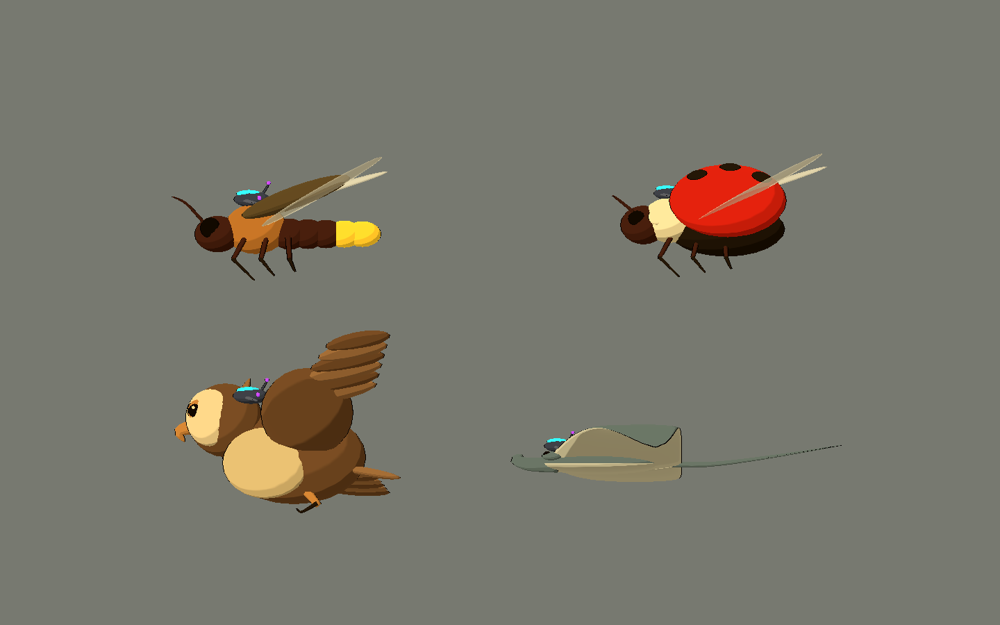
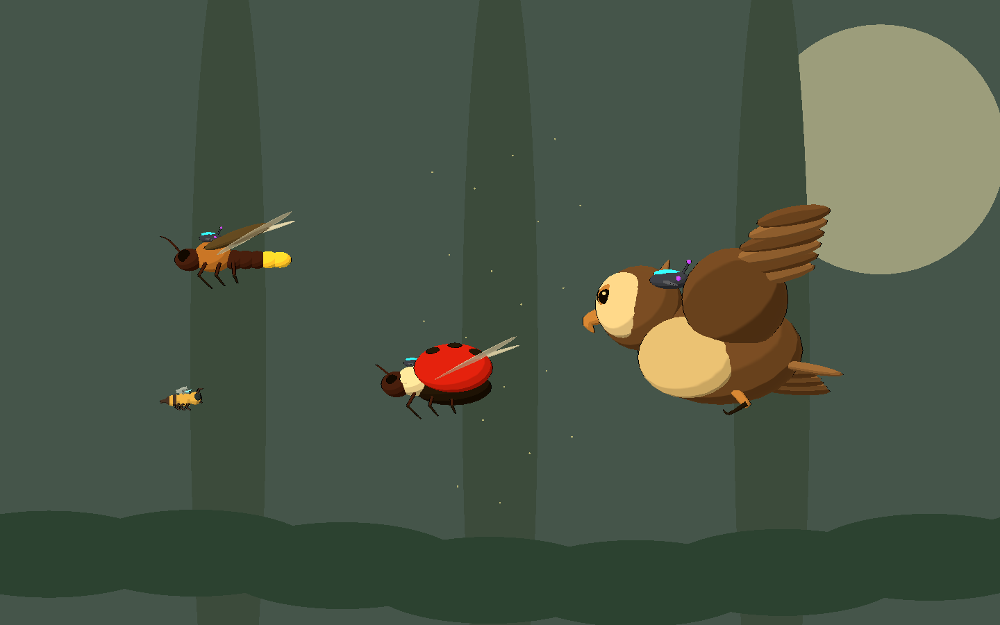
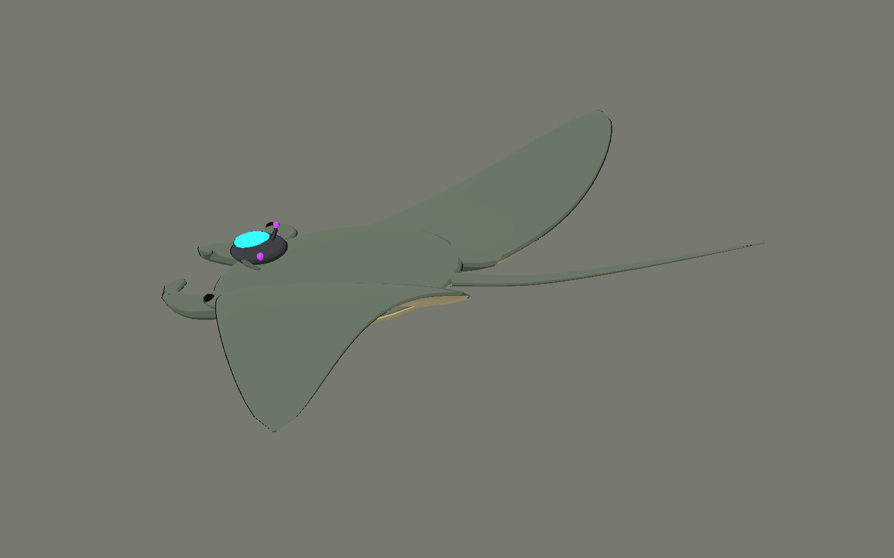

# Bee Alien — tercera tanda: fauna voladora y marina

2026-10-10. Cuatro modelos originales con fuentes `.blend`, GLB y escenas
reutilizables. Se mantiene Style C: 2–3 bandas de iluminación, formas suaves,
contorno fino y rim cálido. Godot 4.x, renderer Compatibility.

## Probar

Abrir `scenes/art_labs/future_biomes_v03.tscn` y ejecutar con **F6**.

- **A / M / E**: aire, mar y estudio.
- **1–4** o «Ver una pieza»: luciérnaga, mariquita, búho y mantarraya.
- **V**: lateral / 3⁄4 de la pieza individual.
- **L**: poner/quitar el dispositivo de control. Conserva toda la geometría natural.
- **H**: ocultar interfaz. El estudio y las fichas individuales quedan sin texto, UI ni entorno.
- **P**: pausar la oscilación suave de las criaturas de galería. No pausa el shader de agua.
- **Flechas**: cambiar vista de galería.





## Modelos

| ID | Diseño / papel propuesto | Triángulos fuente | Mallas |
|---|---|---:|---:|
| `controlled_firefly` | Luciérnaga marrón/ocre en vuelo, seis patas, dos élitros y dos alas membranosas. Dos segmentos terminales amarillos cálidos; receptor externo en tórax. Enjambre nocturno o escolta de señales. | 8.864 | 35 |
| `controlled_flying_ladybird` | Mariquita roja con seis manchas naturales, élitros levantados, dos alas de vuelo y seis patas. Receptor externo sobre el pronoto. Enemigo aéreo compacto. | 9.384 | 39 |
| `controlled_owl` | Búho marrón/crema en pose de vuelo inclinado, discos faciales, ojos ocre, pico curvo, dos alas, plumas redondeadas y dos patas recogidas. Receptor visible junto a nuca/hombro. Gran amenaza aérea o futuro miniboss. | 13.540 | 53 |
| `controlled_manta_ray` | Mantarraya gris natural con vientre claro, dos aletas pectorales amplias, lóbulos cefálicos y cola fina. Receptor externo en la parte anterior del dorso. Amenaza marina de barrido amplio. | 7.280 | 19 |

Estas funciones de combate son propuestas; no se implementaron ataques, daño ni IA.
El manifiesto exacto está en `assets/models/future_biomes_v03/manifest.json`.

## Reglas visuales aplicadas

Toda la tecnología está en el nodo independiente `AlienControlDevice`:
carcasa grafito, lente cian, nodos violetas y abrazaderas externas. La fauna
permanece en `NaturalFauna`. Al liberar no desaparecen alas, patas, ojos ni piel.

La luciérnaga conserva **luz biológica amarilla cálida** en dos segmentos del
abdomen. Es una excepción natural de emisión, no usa cian ni violeta y permanece
encendida al quitar el receptor. Su material `NaturalLantern` se distingue de la
energía alienígena. No se convierte el entorno en neón.

Los puntos de la mariquita son superficies negras adheridas al volumen de los
élitros. Se revisaron desde la cámara lateral para mantener su reconocimiento.

El ala cercana del búho y las aletas de la mantarraya ocultan superficies del
dorso; se recolocaron los receptores cerca de nuca/hombro y del dorso anterior
respectivamente para que la lente se vea desde el plano lateral de juego.

La mantarraya tiene una silueta lateral deliberadamente plana y una pose de
aletas asimétrica. La vista 3⁄4 permite evaluar el ancho completo. No se altera
su anatomía para volverla un monstruo ni se añade aguijón o mutación.

Las escenas de aire y mar son composiciones de revisión. La abeja existente
aparece como referencia de escala en aire. La composición submarina no agrega
un sistema de nado a Bee ni define aún cómo entraría al nivel.

## Archivos nuevos

- `art_source/blender/future_biomes_v03/{ID}.blend`: cuatro fuentes editables.
- `art_source/blender/future_biomes_v03/.gdignore`: evita duplicar la importación Blender/GLB.
- `assets/models/future_biomes_v03/{ID}.glb`, `.import`, `manifest.json`: cuatro exportaciones y datos.
- `scenes/art_labs/assets_v03/{ID}.tscn`: cuatro escenas listas para instanciar.
- `scenes/art_labs/future_biomes_v03.tscn`: galería aislada.
- `scripts/art/future_biomes_lab_v03.gd`: vistas, selección y controles. Reutiliza helpers de V01.
- `tools/art/create_future_biomes_v03.py`: generador reproducible de esta tanda.
- `tools/art/capture_future_biomes_v03.gd`: capturas reales del viewport.
- `tests/art/validate_future_biomes_v03.gd`: validación de estilo, fauna liberable y luz natural.
- Este informe, `docs/art/FAUNA_ROADMAP.md` y `docs/art/future_biomes_v03/*.png`: planificación y 18 capturas.
- Godot genera `.gd.uid` y `.png.import` asociados a los nuevos recursos.

No se modificaron los generadores/modelos de V01/V02 ni los shaders y scripts
compartidos. No se modificaron los otros proyectos ni se importó la biblioteca externa.

## Usar las piezas

Instanciar las escenas de `scenes/art_labs/assets_v03`. Reutilizan
`scripts/art/future_asset_visual.gd`, que aplica el mismo cel shading en editor
y runtime. Los GLB solos contienen materiales PBR de intercambio.

Convención: **X/Y = plano de juego; +Y = arriba; -X = frente**. Blender usa Z
vertical y exporta a Y vertical. Origen en el centro del cuerpo de cada criatura.
`face_right(true)` orienta hacia +X. Ajustar escala en la instancia según el bioma.

Para liberar, llamar `release_control()` o asignar `controlled = false`.
Para restaurar la visual controlada, asignar `controlled = true`.
`Wing_L` / `Wing_R` y `PectoralFin_L` / `PectoralFin_R` quedan separados para
preparar rig o animación posterior. En los insectos, los élitros son piezas
distintas de las alas membranosas.

## Comprobaciones

Blender 5.2.1: cuatro `.blend` guardados y cuatro GLB exportados.
Godot 4.7.2 con GL Compatibility / OpenGL 3.3, Intel Arc B580:

- Validador: **0 fallos**.
- Todas las superficies con Style C; contorno en cuerpos y shader de membrana en alas de insectos.
- Emisión cian/violeta restringida a tecnología externa.
- Única emisión biológica: dos segmentos cálidos del abdomen de la luciérnaga.
- Ocultar/restaurar receptores sin ocultar ninguna malla natural.
- Seis patas y dos alas en cada insecto; seis manchas de mariquita.
- Dos alas y dos patas recogidas en el búho; aletas y cola naturales de mantarraya.
- Tres páginas y selección individual lateral/3⁄4.
- **18 capturas**: tres galerías con UI, tres limpias, ocho vistas individuales
  y cuatro variantes liberadas. Inspección visual y ajustes de manchas/receptores.

```powershell
# Reconstruir sólo V03: sobrescribe sus .blend y GLB.
& 'C:\Program Files\Blender Foundation\Blender 5.2\blender.exe' --background --python tools/art/create_future_biomes_v03.py

$beeGodot = 'C:\Users\rea_0\Downloads\Godot_v4.7.2-stable_win64.exe\Godot_v4.7.2-stable_win64_console.exe'
& $beeGodot --headless --path . --editor --import --quit
& $beeGodot --headless --path . --script tests/art/validate_future_biomes_v03.gd
& $beeGodot --path . --resolution 1440x900 --script tools/art/capture_future_biomes_v03.gd
```

## Límites y problemas

Son **POCs visuales**, sin rig, clips, colisiones ni combate. Las poses de vuelo
son estáticas; la galería sólo oscila su posición. Antes de integrar enjambres,
consolidar mallas/superficies y medir draw calls. El búho es la pieza más costosa
por sus subobjetos de plumas, separados para edición.

Compatibility mantiene iluminación plana y lentes luminosas, sin bloom HDR.
La mantarraya exige comprobar escala y contraste cuando exista el nivel marino,
pues el cuerpo se ve más fino en vista lateral que en 3⁄4.

El entorno restringido informa avisos de caché/configuración de usuario de
Godot y miniaturas de Blender; el editor informa recursos retenidos al cerrarse.
No impidieron guardar los modelos, validar, ejecutar ni capturar. Las ejecuciones
de runtime no reportaron errores de script o shader. Logs en `dev/future_biomes_v03_*.log`.
