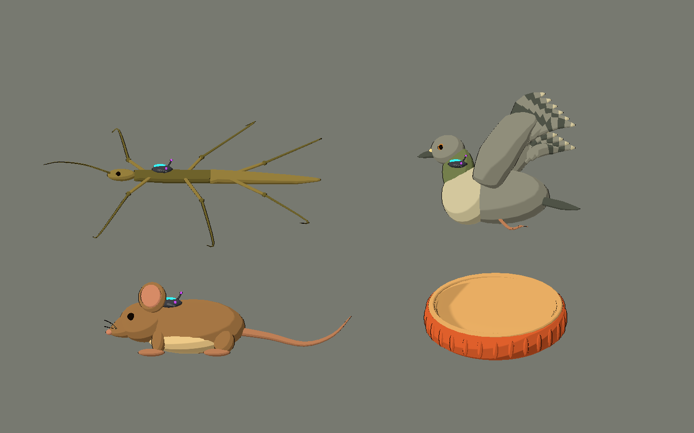
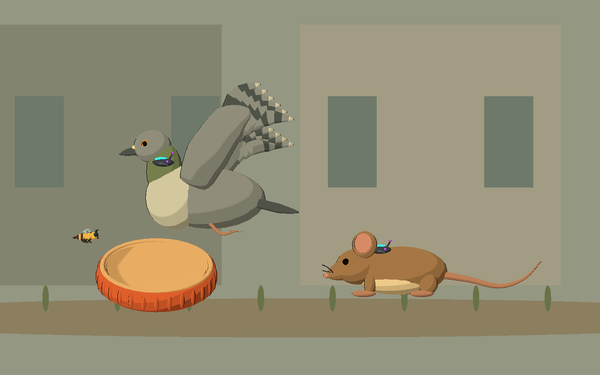
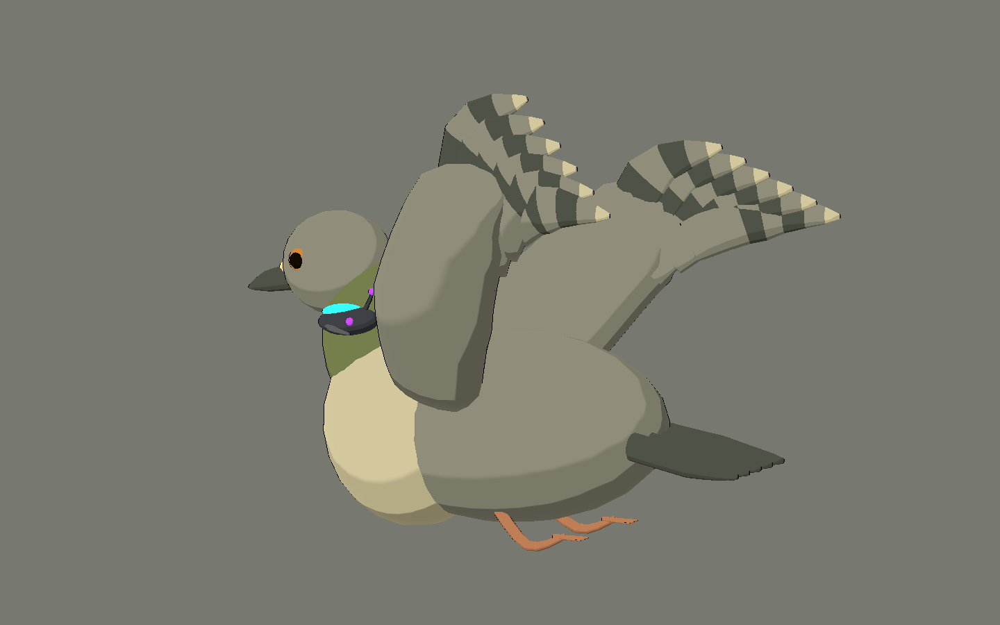

# Bee Alien — cuarta tanda: bosque y jardín residencial

2026-10-10. Cuatro modelos originales, con fuentes Blender y exportaciones GLB.
Style C compartido: tres bandas de iluminación, contorno oscuro fino, rim suave
y paleta natural. Galería aislada, Godot 4.x con renderer Compatibility.

## Probar

Abrir `scenes/art_labs/future_biomes_v04.tscn` y ejecutar con **F6**.

- **F / R / E**: bosque, residencial y estudio.
- **1–4** o «Ver una pieza»: bicho palo, paloma, ratón y tapa.
- **V**: lateral / tres cuartos de la pieza individual.
- **L**: poner/quitar receptor de los animales, manteniendo su anatomía completa.
- **H**: ocultar interfaz; estudio y fichas individuales quedan sin texto ni entorno.
- **P**: pausar la oscilación de la paloma en la galería. La pose de alas es estática.
- **Flechas**: cambiar página.





## Piezas

| ID | Diseño / uso propuesto | Triángulos fuente | Mallas |
|---|---|---:|---:|
| `controlled_stick_insect` | Bicho palo ocre/oliva: cuerpo fino, seis patas con articulaciones, dos antenas largas. Receptor externo pequeño sobre tórax. Emboscada entre ramas. | 7.416 | 33 |
| `controlled_pigeon` | Paloma gris/crema, cuello oliva sin emisión, pico corto, dos alas levantadas con bandas naturales, cola y dos patas recogidas. Receptor en nuca. Cruce aéreo residencial. | 11.008 | 45 |
| `controlled_mouse` | Ratón marrón cálido, vientre crema, dos orejas redondas con interior rosado, bigotes, cuatro patas y cola larga. Receptor dorsal. Amenaza de suelo liberable. | 10.748 | 32 |
| `giant_bottle_cap` | Tapa humana terracota: casco cóncavo continuo, interior de metal cálido, borde enrollado y 28 nervaduras de agarre. Refugio/plataforma a escala de Bee. | 5.984 | 30 |

Los usos son propuestas de diseño. No se implementan ataques, IA ni colisiones.
Datos exactos en `assets/models/future_biomes_v04/manifest.json`.

## Criterios visuales

Los animales tienen `NaturalFauna` y `AlienControlDevice` separados. Toda emisión
cian/violeta pertenece al segundo: carcasa grafito, lente, nodos y abrazaderas.
No hay emisión natural en esta tanda. La tapa no tiene tecnología ni receptor.

Las marcas de la paloma son asignaciones de material sobre las propias plumas:
no sobresalen como dispositivos. Alas y patas quedan como subárboles separados.
La pose diferencia ala cercana y lejana para conservar una lectura lateral clara.

El bicho palo muestra las seis patas en una pose extendida de revisión; al riggear
habrá que adaptar los apoyos a las ramas reales. El ratón mantiene hocico corto,
orejas grandes y cola fina; una futura rata deberá tener otras proporciones.

El borde y fondo de la tapa forman una malla cerrada con cavidad visible en tres
cuartos. Los centros usan abanicos triangulados sin caras degeneradas.

Bosque y residencial son composiciones de revisión con formas simples y fondos
de poco contraste. No constituyen niveles completos ni nuevos modelos de casas
o árboles exportables. La abeja existente aparece como referencia de escala.

## Archivos creados y modificados

- `art_source/blender/future_biomes_v04/{ID}.blend`: cuatro fuentes editables y `.gdignore`.
- `assets/models/future_biomes_v04/{ID}.glb`: cuatro modelos, sus `.import` y `manifest.json`.
- `scenes/art_labs/assets_v04/{ID}.tscn`: cuatro escenas reutilizables con cel shading.
- `scenes/art_labs/future_biomes_v04.tscn`: galería.
- `scripts/art/future_biomes_lab_v04.gd`: vistas y controles; extiende los helpers de V01.
- `tools/art/create_future_biomes_v04.py`: generador original reproducible.
- `tools/art/capture_future_biomes_v04.gd`: capturas del viewport real.
- `tests/art/validate_future_biomes_v04.gd`: verifica importación, materiales, emisión,
  contornos, liberación y estructura anatómica de estas piezas.
- `docs/art/future_biomes_v04/*.png`: 17 capturas y sus recursos de importación.
- Este informe y actualización de `docs/art/FAUNA_ROADMAP.md`.
- Godot genera `.gd.uid` para los scripts nuevos; logs de comprobación en `dev/future_biomes_v04_*.log`.

Se reutilizan `future_asset_visual.gd` y `BeeToonStyle` sin modificarlos.
Las tandas anteriores, el juego principal y otros proyectos quedan sin cambios de esta tarea.

## Integración

Instanciar las escenas de `scenes/art_labs/assets_v04`. Los GLB solos contienen
materiales de intercambio; las escenas aplican el toon compartido en Godot.
Plano de juego **X/Y**, arriba **+Y**, frente **-X**. `face_right(true)` orienta a +X.
Blender usa Z vertical y exporta Y vertical. Ajustar escala por instancia.

En animales: `release_control()` o `controlled = false` quita el receptor;
`controlled = true` lo restaura. La tapa no responde a liberación. El origen
de los animales está junto al centro del cuerpo; la tapa, en el centro del casco.

## Verificación y límites

Blender 5.2.1 guardó cuatro `.blend` y exportó cuatro GLB. Godot 4.7.2:
**0 fallos** en el validador después de los ajustes visuales. Render real con
GL Compatibility / OpenGL 3.3, Intel Arc B580. Se revisaron capturas laterales,
tres cuartos y composiciones; se corrigió la superposición de ala/interfaz.

17 capturas: tres páginas con UI, tres limpias, ocho vistas individuales y tres
animales liberados. Se comprobó que todas las superficies tienen toon/contorno,
que la emisión queda en tecnología y que liberar no oculta geometría natural.
Se verifican seis patas y dos antenas del insecto, dos alas/patas de paloma,
cuatro patas/dos orejas/cola de ratón y nervaduras/casco de tapa.

```powershell
# Reconstruye sólo V04; sobrescribe sus fuentes y GLB.
& 'C:\Program Files\Blender Foundation\Blender 5.2\blender.exe' --background --python tools/art/create_future_biomes_v04.py
$beeGodot = 'C:\Users\rea_0\Downloads\Godot_v4.7.2-stable_win64.exe\Godot_v4.7.2-stable_win64_console.exe'
& $beeGodot --headless --path . --editor --import --quit
& $beeGodot --headless --path . --script tests/art/validate_future_biomes_v04.gd
& $beeGodot --path . --resolution 1440x900 --script tools/art/capture_future_biomes_v04.gd
```

Son **POCs visuales**, sin rig, clips, colisiones ni combate. La división en
subobjetos facilita edición; antes de integrar al juego, consolidar superficies,
reducir draw calls y medir rendimiento. La pigmentación de plumas agrega varias
superficies por pluma; convendrá agruparlas o usar una textura al optimizar.

El entorno restringido informa errores de escritura de caché/configuración de
usuario de Godot y recursos retenidos al cerrar el editor. No impidieron importar,
validar ni capturar. Runtime sólo informó la caché de shaders no disponible;
no hubo errores de script o compilación de shader. Compatibility no usa bloom HDR.
