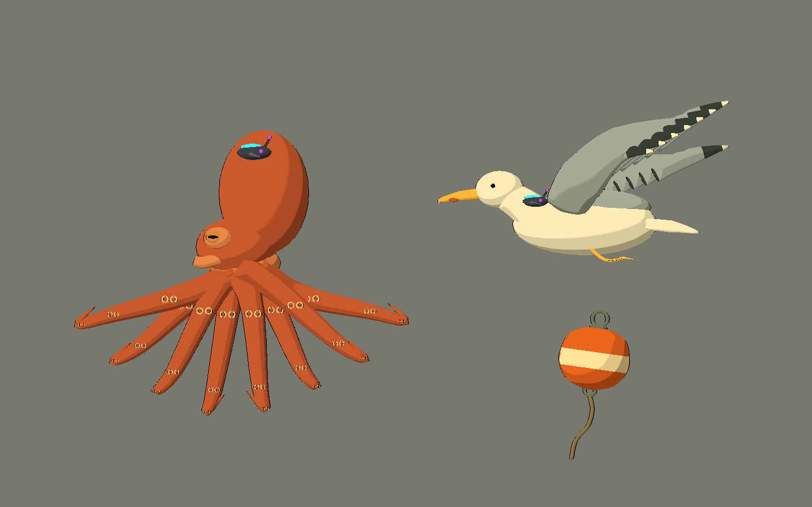
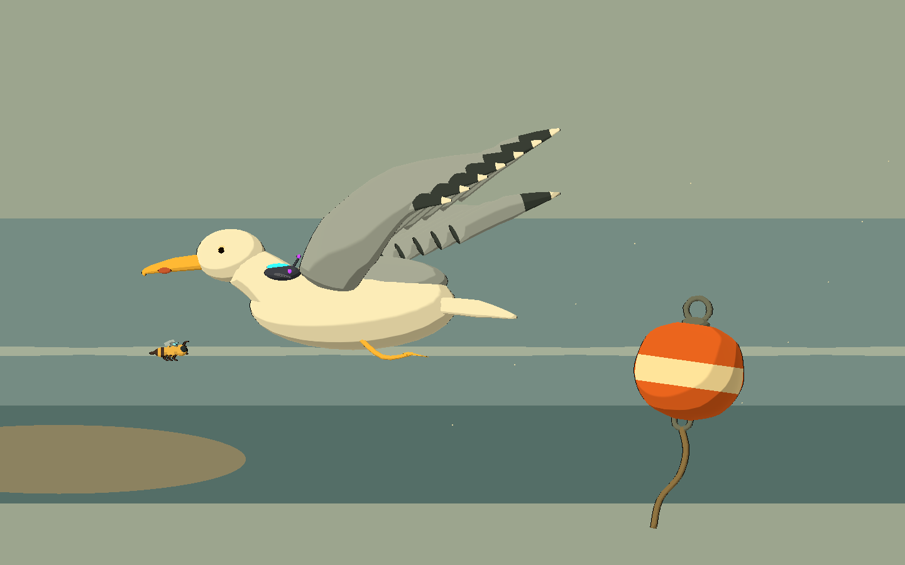
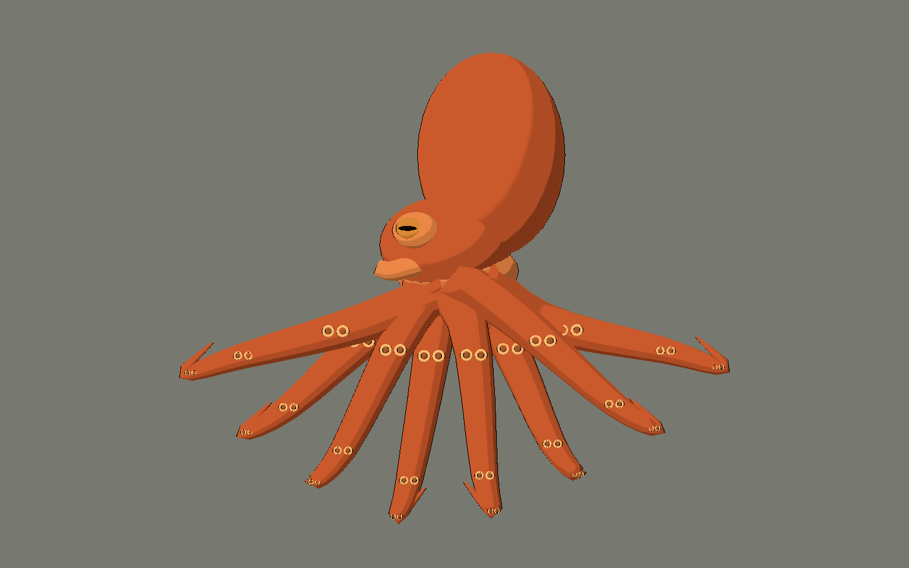

# Bee Alien — quinta tanda: costa y fauna marina

2026-10-10. Tres modelos originales con fuentes Blender, GLB y escenas visuales
reutilizables para Godot 4.x Compatibility. Conservan Style C: bandas toon,
contorno oscuro fino, rim suave y materiales naturales. No se importaron assets externos.

## Probar

Abrir `scenes/art_labs/future_biomes_v05.tscn` y ejecutar con **F6**.

- **C / M / E**: costa, submarino y estudio.
- **1–3** o «Ver una pieza»: pulpo, gaviota y boya.
- **V**: vista lateral / tres cuartos de la pieza individual.
- **L**: quitar/restaurar el dispositivo de los animales.
- **H**: ocultar interfaz. Las fichas y el estudio limpio no tienen texto ni entorno.
- **P**: pausar la oscilación de galería; no pausa el shader de agua.
- **Flechas**: cambiar página.





## Modelos

| ID | Diseño / papel propuesto | Triángulos fuente | Mallas |
|---|---|---:|---:|
| `controlled_octopus` | Pulpo terracota, manto ovoide suave, cabeza diferenciada, ojos de pupila horizontal, sifón y ocho brazos en abanico con extremos curvados. Receptor externo sobre el manto. Amenaza marina de alcance amplio. | 20.144 | 34 |
| `controlled_gull` | Gaviota crema/gris, pico amarillo largo con marca natural rojiza, alas largas de puntas oscuras, cola y dos patas palmeadas recogidas. Receptor junto al hombro. Patrulla costera o picada futura. | 11.348 | 43 |
| `coastal_buoy` | Boya humana naranja con banda crema, casco redondeado, asa superior, argolla inferior y cabo curvo de amarre. Hito o elemento de escala costero. Sin emisión ni tecnología alienígena. | 4.592 | 7 |

Los papeles de combate son propuestas: no se implementaron ataques, daño ni IA.
El manifiesto reproducible está en `assets/models/future_biomes_v05/manifest.json`.

## Anatomía y estilo

Cada animal conserva `NaturalFauna` separado de `AlienControlDevice`. Carcasa
grafito, lente cian, nodos violetas y abrazaderas permanecen en el dispositivo.
No hay luz biológica en esta tanda. Al liberar siguen visibles todas las mallas
naturales. La boya no tiene dispositivo ni responde a liberación.

El pulpo tiene **ocho subárboles `Arm_01`…`Arm_08`**. Cada brazo contiene su piel y
un grupo `NaturalSuckers` con tres pares de ventosas: 48 en total. Se agrupan por
brazo para evitar un nodo por ventosa. Anillos claros y centro marrón conservan
su lectura a pequeña escala. El abanico es una pose estática de revisión lateral;
no es un esqueleto terminado ni una simulación de brazos sobre el suelo.

La gaviota se diferencia de la paloma V04 por el cuerpo más fino, el pico largo
y la extensión de las alas. Las puntas oscuras son material de las plumas,
sin piezas tecnológicas añadidas. `Wing_L`, `Wing_R`, `TuckedLeg_*` y
`NaturalTail` quedan separados para un futuro rig.

El casco de la boya usa un perfil suavizado y conserva una banda de pintura,
sin convertirla en una baliza luminosa. `MooringRope` permite ocultar o sustituir
el cabo según su colocación. La galería muestra el conjunto completo.

La costa incluye la abeja existente como referencia de escala. Fondos, rocas,
arena y algas son formas de composición para revisión, no un kit de entorno
exportado. La vista submarina no agrega nado a Bee ni define la entrada al nivel.

## Archivos creados y modificados

- `art_source/blender/future_biomes_v05/{ID}.blend`: tres fuentes y `.gdignore`.
- `assets/models/future_biomes_v05/{ID}.glb`: tres exportaciones, `.import` y `manifest.json`.
- `scenes/art_labs/assets_v05/{ID}.tscn`: tres escenas listas para instanciar con toon.
- `scenes/art_labs/future_biomes_v05.tscn`: galería aislada.
- `scripts/art/future_biomes_lab_v05.gd`: páginas, selección y controles.
- `tools/art/create_future_biomes_v05.py`: generador original reproducible.
- `tools/art/capture_future_biomes_v05.gd`: capturas del viewport real.
- `tests/art/validate_future_biomes_v05.gd`: validación de estilo, emisión,
  liberación, ocho brazos y estructura de gaviota/boya.
- `docs/art/future_biomes_v05/*.png`: 14 capturas y sus recursos de importación.
- Este informe y actualización de `docs/art/FAUNA_ROADMAP.md`.
- Godot genera `.gd.uid` asociados; logs en `dev/future_biomes_v05_*.log`.

Se reutilizan los helpers de galería V01, `future_asset_visual.gd` y los shaders
compartidos sin modificarlos. Las tandas anteriores y los scripts de combate
existentes no fueron editados por esta tarea.

## Integración

Instanciar las escenas de `scenes/art_labs/assets_v05`. El GLB solo contiene
materiales de intercambio; la escena aplica el cel shading compartido.
Convención: plano de juego **X/Y**, arriba **+Y**, frente **-X**; Blender exporta
su Z vertical a Y vertical. `face_right(true)` gira hacia +X. Ajustar escala por
instancia según el nivel. Origen del pulpo en cabeza/base del manto; gaviota
en cuerpo; boya en el centro del casco, con el cabo extendido por debajo.

Para liberar animales: `release_control()` o `controlled = false`.
Para restaurar receptor: `controlled = true`. Esto sólo cambia la visual.

## Verificación

Blender 5.2.1 guardó tres `.blend` y exportó tres GLB. Godot 4.7.2, renderer
GL Compatibility / OpenGL 3.3, Intel Arc B580: **0 fallos** en el validador final.

- Toon y contorno en todas las superficies.
- Emisión únicamente dentro de `AlienControlDevice`; boya no emisiva.
- Quitar/restaurar receptor sin ocultar anatomía.
- Ocho brazos, ocho grupos de ventosas y dos pupilas de pulpo.
- Dos alas, dos patas palmeadas y cola de gaviota.
- Asa y cabo separados en boya.
- Tres páginas, selección individual y fichas sin UI.
- **14 capturas**: tres galerías con UI, tres limpias, seis fichas lateral/tres
  cuartos y dos variantes liberadas. Inspección visual de siluetas, ventosas,
  receptores, perfil de boya y márgenes de encuadre.

```powershell
# Reconstruye sólo V05; sobrescribe sus fuentes y GLB.
& 'C:\Program Files\Blender Foundation\Blender 5.2\blender.exe' --background --python tools/art/create_future_biomes_v05.py
$beeGodot = 'C:\Users\rea_0\Downloads\Godot_v4.7.2-stable_win64.exe\Godot_v4.7.2-stable_win64_console.exe'
& $beeGodot --headless --path . --editor --import --quit
& $beeGodot --headless --path . --script tests/art/validate_future_biomes_v05.gd
& $beeGodot --path . --resolution 1440x900 --script tools/art/capture_future_biomes_v05.gd
```

## Límites y problemas

Son **POCs visuales**, sin rigs, clips, colisiones ni combate. La oscilación de
galería mueve el conjunto; no anima alas, brazos o cabo. El pulpo necesita un
POC dedicado de rig y apoyos antes de integrarlo. Para gameplay, consolidar
superficies y medir draw calls; especialmente plumas con varios materiales y
grupos de ventosas. No se hicieron mediciones de rendimiento de un nivel.

Compatibility conserva las bandas y lentes luminosas sin bloom HDR. El entorno
restringido informa errores al escribir caché/configuración de usuario y recursos
retenidos al cerrar el editor. La ejecución final sólo informó caché de shaders
no disponible; no hubo errores de script ni compilación de shader. Estos avisos
no impidieron guardar, importar, validar o capturar las piezas.
