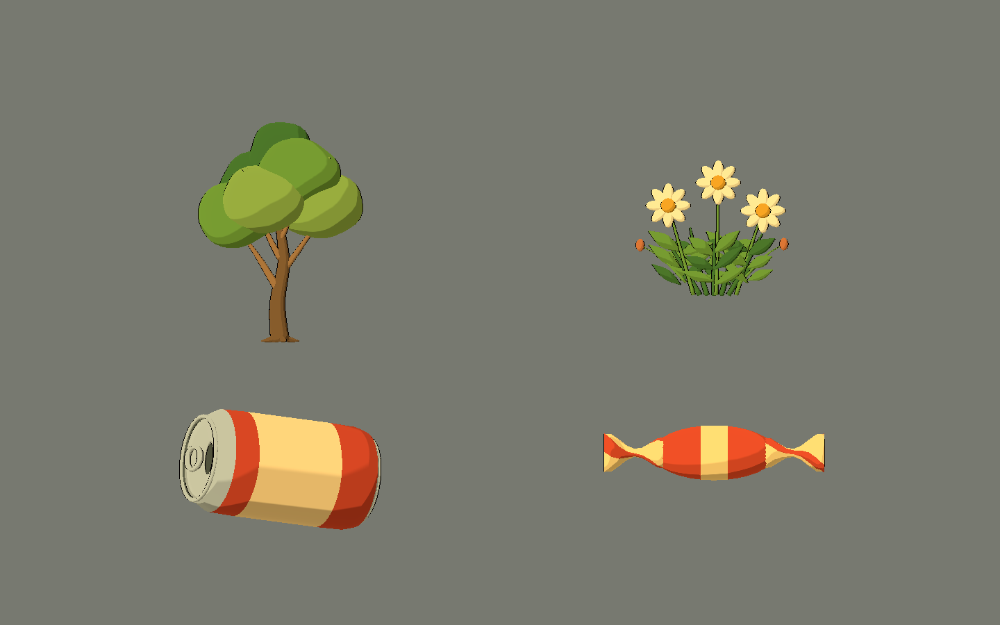
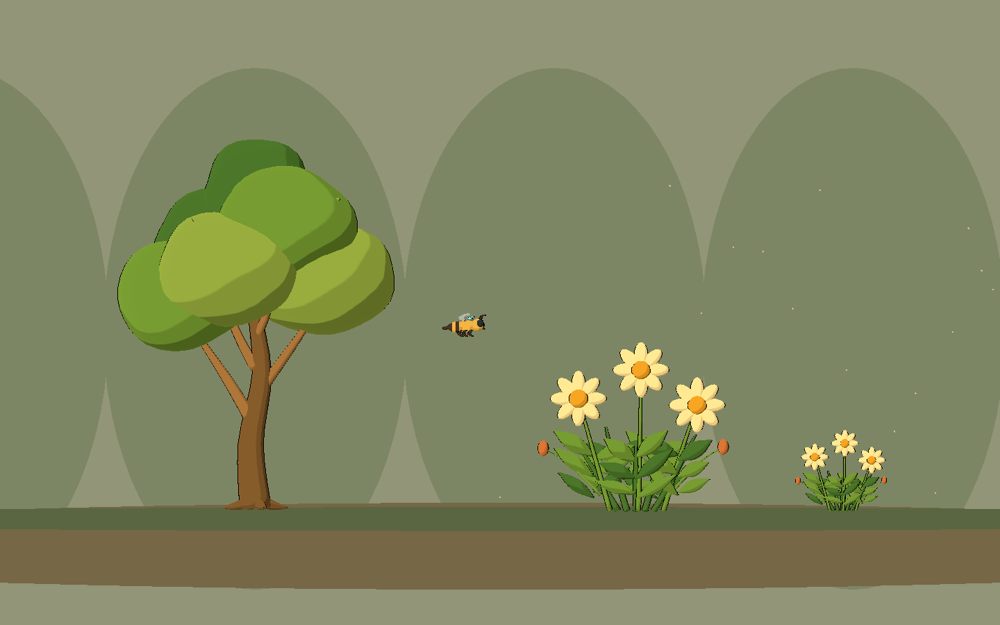
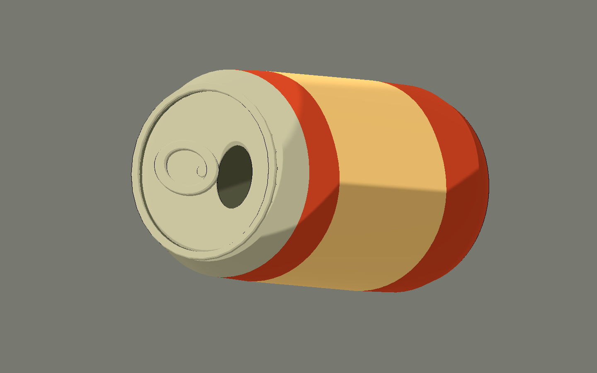

# Bee Alien — sexta tanda: vegetación y objetos de suelo

2026-10-10. Cuatro modelos originales con fuentes `.blend`, GLB y escenas
visuales reutilizables. Se mantiene Style C: bandas toon, contorno oscuro fino,
rim suave y formas de volumen redondeado. Godot 4.x Compatibility.

## Probar

Abrir `scenes/art_labs/future_biomes_v06.tscn` y ejecutar con **F6**.

- **J / S / E**: jardín, suelo residencial y estudio.
- **1–4** o «Ver una pieza»: árbol, arbusto, lata y caramelo.
- **V**: lateral / tres cuartos de la pieza individual.
- **H**: ocultar interfaz; estudio y fichas quedan sin texto ni entorno.
- **Flechas**: cambiar página.

Esta galería presenta entorno estático. No incluye controles de liberación
porque ninguna pieza tiene dispositivo de control alienígena.





## Modelos

| ID | Diseño / uso propuesto | Triángulos fuente | Mallas |
|---|---|---:|---:|
| `garden_sapling` | Árbol joven de hoja ancha: tronco curvo, cuatro ramas, cuatro raíces y copa de seis lóbulos orgánicos suaves en verdes naturales. Obstáculo visual o capa media de jardín/bosque. | 7.904 | 11 |
| `flowering_shrub` | Mata floral de cinco tallos principales, 30 hojas lanceoladas, tres margaritas de ocho pétalos crema con centro ocre y dos capullos conectados a sus tallos. Detalle de primer plano. | 11.784 | 19 |
| `empty_drink_can` | Lata genérica vacía, tumbada, pintura terracota y franja crema, bordes enrollados, anilla separada, abertura real y abolladura suave. Hito o cobertura a escala humana. | 4.572 | 6 |
| `wrapped_candy` | Caramelo rojo/crema envuelto: cápsula suave con franja central y dos extremos retorcidos. Objeto del suelo o futuro coleccionable visual. | 2.024 | 3 |

Los usos de cobertura/coleccionable son propuestas; no se agregó lógica de
gameplay. Datos exactos en `assets/models/future_biomes_v06/manifest.json`.

## Diseño y estilo

**Toda esta tanda es no emisiva.** No tiene cian/violeta de energía, dispositivos
de control, marcas ni logos. Madera, verdes, crema, ocres y pintura terracota
mantienen el carácter natural y artesanal del juego.

El árbol usa seis masas de copa con deformación suave de baja frecuencia para
evitar un conjunto de esferas idénticas. Se agrupan en `Canopy` conservando
topología y materiales; tronco, ramas y raíces permanecen editables en `Wood`.

Las hojas del arbusto son volúmenes cerrados y ligeramente convexos por ambos
lados, con puntas finas. Se varían alturas e inclinaciones para romper la rejilla
visual. `ShrubLeaves` agrupa las hojas. Cada `Flower_01`…`Flower_03` contiene
pétalos agrupados y centro; sus tallos están en `Stems`. Para extraer una flor
completa, copiar también su `FlowerStem` desde la fuente Blender.

La lata conserva interior y fondo, una tapa con abertura oval real y su anilla.
El metal usa color gris cálido mate bajo el mismo toon. La vista tres cuartos
se orienta hacia la abertura. La inclinación está guardada en `CanAssembly` y
su origen queda cerca del apoyo en el suelo.

El caramelo tiene extremos con torsión y pliegues amplios; la franja central
se delimita con cortes de geometría para mantener bordes limpios. Todo es
geometría original y materiales planos, sin texturas externas.

La abeja existente aparece en jardín y suelo para revisar escala. Los fondos
y el terreno simple son composiciones de galería, no un nivel terminado ni
modelos adicionales exportados. El estudio ajusta tamaños por legibilidad;
sus proporciones entre árbol, flores y objetos no son medidas de mundo real.

## Archivos creados y modificados

- `art_source/blender/future_biomes_v06/{ID}.blend`: cuatro fuentes y `.gdignore`.
- `assets/models/future_biomes_v06/{ID}.glb`: cuatro modelos, `.import` y `manifest.json`.
- `scenes/art_labs/assets_v06/{ID}.tscn`: cuatro escenas visuales con toon.
- `scenes/art_labs/future_biomes_v06.tscn`: galería aislada.
- `scripts/art/future_biomes_lab_v06.gd`: vistas, selección y controles; reutiliza helpers de V01.
- `tools/art/create_future_biomes_v06.py`: generador original reproducible.
- `tools/art/capture_future_biomes_v06.gd`: capturas reales del viewport.
- `tests/art/validate_future_biomes_v06.gd`: verificación de materiales, emisión y estructura.
- `docs/art/future_biomes_v06/*.png`: 14 capturas y sus recursos de importación.
- Este informe y `docs/art/ENVIRONMENT_ROADMAP.md`: inventario y nuevas ideas del usuario.
- Godot genera `.gd.uid` asociados; logs en `dev/future_biomes_v06_*.log`.

Se reutilizan `future_asset_visual.gd` y `BeeToonStyle` sin modificarlos. No se
editaron tandas anteriores ni scripts del juego principal. No se importó la
biblioteca externa ni se modificaron los otros proyectos.

## Integración

Instanciar las escenas de `scenes/art_labs/assets_v06`. Los GLB solos contienen
materiales de intercambio; las escenas aplican el cel shading compartido en
Godot. Plano de juego **X/Y**, arriba **+Y**. Blender usa Z vertical y exporta
a Y vertical. Los props son visuales y no tienen un frente de combate.

Los orígenes de árbol, arbusto y caramelo están en la base; la lata está
preorientada cerca de su apoyo. Ajustar escala y altura por instancia. Mantener
`NaturalPlant`, `Wood`, `Crown`, `Stems`, `FlowerHeads`, `CanAssembly` y `Wrapper`
como grupos de edición; no son rigs ni controladores físicos.

## Comprobaciones

Blender 5.2.1 guardó cuatro `.blend` y exportó cuatro GLB. Godot 4.7.2, renderer
GL Compatibility / OpenGL 3.3, Intel Arc B580: **0 fallos** en el validador final.

- Todas las superficies con toon y contorno.
- Sin emisión ni dispositivos alienígenas en vegetación u objetos humanos.
- El estado de control no oculta ninguna malla de entorno.
- Copa, cuatro ramas y cuatro raíces de árbol.
- Tres grupos de flores y hojas agrupadas de arbusto.
- Tapa abierta, anilla y dos bordes de lata.
- Dos extremos retorcidos de caramelo.
- Tres páginas, selección individual y fichas limpias.
- **14 capturas**: tres galerías con UI, tres limpias y ocho fichas lateral/tres
  cuartos. Inspección visual de hojas, bandas de color, abertura y apoyos de suelo.

```powershell
# Reconstruye sólo V06; sobrescribe sus fuentes y GLB.
& 'C:\Program Files\Blender Foundation\Blender 5.2\blender.exe' --background --python tools/art/create_future_biomes_v06.py
$beeGodot = 'C:\Users\rea_0\Downloads\Godot_v4.7.2-stable_win64.exe\Godot_v4.7.2-stable_win64_console.exe'
& $beeGodot --headless --path . --editor --import --quit
& $beeGodot --headless --path . --script tests/art/validate_future_biomes_v06.gd
& $beeGodot --path . --resolution 1440x900 --script tools/art/capture_future_biomes_v06.gd
```

## Límites y problemas

Son **POCs visuales**: sin colisiones, viento, físicas, interacción o recogida.
La lata no se puede empujar y el caramelo no otorga salud. Añadir colisiones
simples y medir rendimiento al integrarlos. El arbusto concentra más geometría
por los pétalos y hojas; reducir detalle o preparar LOD al repetir muchas matas.

El entorno restringido informa errores al escribir caché/configuración de
usuario de Godot y recursos retenidos al cerrar el editor. Runtime sólo informa
la caché de shaders no disponible; no hubo errores de script ni compilación
de shader. Los avisos no impidieron guardar, importar, validar o capturar.
