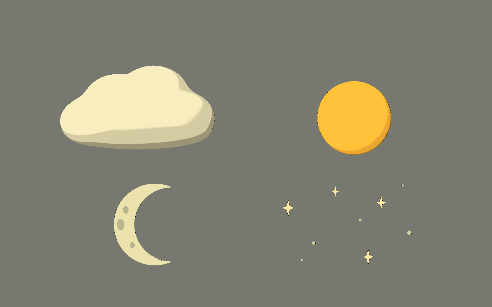
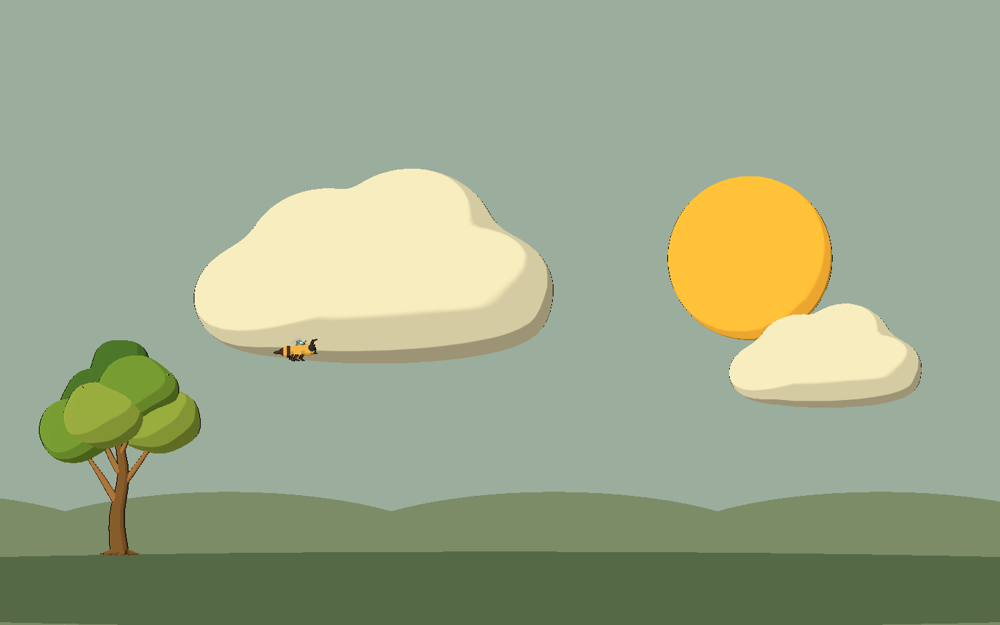
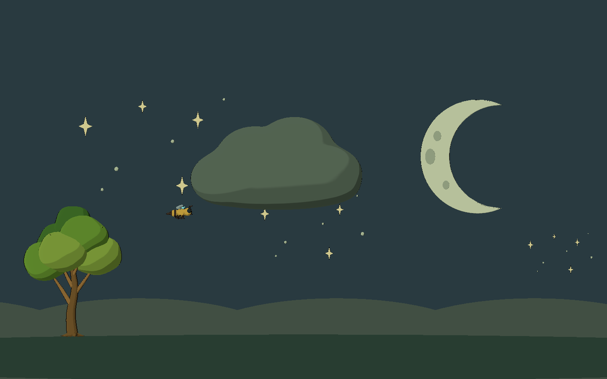

# Bee Alien — séptima tanda: cielo de día y noche

2026-10-10. Cuatro modelos originales con fuentes Blender, GLB y escenas visuales
para Godot 4.x Compatibility. Volúmenes suaves, bandas toon y contorno discreto
para acompañar el plano de juego. Sin texturas externas, marcas ni energía alienígena.

## Probar

Abrir `scenes/art_labs/future_biomes_v07.tscn` y ejecutar con **F6**.

- **D / N / E**: día, noche y estudio.
- **1–4** o «Ver una pieza»: nube, sol, luna y estrellas.
- **V**: lateral / tres cuartos de la pieza individual.
- **H**: ocultar interfaz. Estudio y fichas quedan sin texto ni entorno.
- **P**: pausar la deriva lenta de las nubes en la galería.
- **Flechas**: cambiar página.





## Modelos

| ID | Diseño / uso | Triángulos fuente | Mallas |
|---|---|---:|---:|
| `sky_cloud` | Nube de un solo cuerpo cerrado: contorno lobulado, base baja y superficies abombadas suaves por delante y detrás. Elemento de fondo con tinte por instancia. | 5.888 | 1 |
| `sky_sun` | Disco solar redondeado ocre/dorado, con espesor suave; sin caras, rayos puntiagudos ni aros tecnológicos. Elemento de cielo diurno. | 2.208 | 1 |
| `sky_crescent_moon` | Creciente sólido biselado, recorte geométrico real y tres manchas discretas en la superficie frontal. Elemento de cielo nocturno. | 3.692 | 4 |
| `sky_star_cluster` | Grupo disperso de nueve estrellas: cuatro destellos de cuatro puntas y cinco puntos suaves, en crema y gris cálido. | 2.640 | 9 |

El manifiesto está en `assets/models/future_biomes_v07/manifest.json`. Las
fuentes contienen mallas cerradas y sin caras degeneradas, comprobadas por
el generador antes de guardar/exportar.

## Perfil visual

`scripts/art/future_sky_visual.gd` reutiliza los shaders de `BeeToonStyle`.
Aplica contorno de **0,0011** frente a 0,0023 de los props cercanos y rim de
**0,12** para una presencia más suave. Cada instancia tiene copias locales de
los materiales; cambiar su `tint` no altera otras instancias ni la caché de estilo.

Las manchas de la luna usan toon sin contorno propio para evitar aros negros.
El contorno exterior permanece fino. La nube usa anillos radiales y una silueta
suavizada, sin concavidades internas que generen islas de sombra muy marcadas.

Todos los materiales tienen emisión explícita desactivada. Sol y estrellas se
presentan mediante color e iluminación toon; no incorporan luces, bloom ni
energía cian/violeta. El rim sigue siendo el componente suave del shader común.

La luna tiene un creciente real, sin una esfera oscura superpuesta ni un quad
con transparencia. El sol y la luna son volúmenes de poca profundidad, pensados
para vista lateral y tres cuartos moderados, no para representar planetas
astronómicos desde cualquier ángulo. Los destellos son una convención ilustrada.

La galería ajusta ambiente y luz direccional entre día y noche para revisar la
composición. La nube nocturna recibe tinte por instancia. La abeja existente y
el árbol V06 sirven como referencias; colinas y suelo son formas de revisión,
no nuevos modelos exportados.

## Archivos creados y modificados

- `art_source/blender/future_biomes_v07/{ID}.blend`: cuatro fuentes y `.gdignore`.
- `assets/models/future_biomes_v07/{ID}.glb`: cuatro modelos, `.import` y `manifest.json`.
- `scenes/art_labs/assets_v07/{ID}.tscn`: cuatro escenas visuales con perfil de cielo.
- `scenes/art_labs/future_biomes_v07.tscn`: galería aislada.
- `scripts/art/future_sky_visual.gd`: toon, contorno fino, rim suave y tinte local.
- `scripts/art/future_biomes_lab_v07.gd`: vistas, iluminación de revisión y deriva de nubes.
- `tools/art/create_future_biomes_v07.py`: generador original reproducible.
- `tools/art/capture_future_biomes_v07.gd`: capturas reales del viewport.
- `tests/art/validate_future_biomes_v07.gd`: estilo, estructura y aislamiento del tinte.
- `docs/art/future_biomes_v07/*.png`: 14 capturas y sus recursos de importación.
- Este informe y actualización de `docs/art/ENVIRONMENT_ROADMAP.md`.
- Godot genera `.gd.uid` asociados; logs en `dev/future_biomes_v07_*.log`.

Los shaders compartidos, las tandas anteriores y los scripts de gameplay no
se modificaron. No se importaron assets de la biblioteca externa ni se tocaron
los otros proyectos.

## Integración

Instanciar las escenas de `scenes/art_labs/assets_v07`. Los GLB solos contienen
materiales de intercambio; las escenas aplican el perfil de cielo. Plano visible
**X/Y**, arriba **+Y**, cámara desde **+Z** hacia el origen. Blender usa Z arriba
y la superficie frontal mira hacia -Y. Los orígenes están cerca del centro visual;
ajustar posición, escala y distancia del plano según el nivel.

```gdscript
# En una instancia de sky_cloud: sólo cambia sus propios materiales.
cloud.tint = Color(0.43, 0.49, 0.48)
cloud.tint = Color.WHITE # Recupera los colores originales, sin acumulación.
```

Las estrellas conservan nodos separados `StarGlint_*` y `StarDot_*` para ajustar
su distribución desde Blender o una escena heredada. Ajustar la escala del grupo
para fondo distante; la escala de estudio sólo ayuda a revisar el diseño.

## Comprobaciones

Blender 5.2.1: cuatro `.blend` guardados y cuatro GLB exportados. Verificación
de mallas cerradas y caras con área positiva en todas las fuentes.
Godot 4.7.2, GL Compatibility / OpenGL 3.3, Intel Arc B580:

- **0 fallos** en el validador final.
- Toon y contorno fino en las piezas; manchas lunares sin aros oscuros.
- Sin dispositivos, emisión explícita ni luces dentro de los modelos.
- Nube de una malla, creciente sólido, tres manchas lunares y nueve estrellas.
- Tinte independiente por instancia y restauración del color original.
- Tres páginas, selección lateral/tres cuartos y fichas limpias.
- **14 capturas**: tres galerías con UI, tres limpias y ocho fichas individuales.
- Arranque de la galería comprobado con `--quit-after 10`.

```powershell
# Reconstruye sólo V07; sobrescribe sus fuentes y GLB.
& 'C:\Program Files\Blender Foundation\Blender 5.2\blender.exe' --background --python tools/art/create_future_biomes_v07.py
$beeGodot = 'C:\Users\rea_0\Downloads\Godot_v4.7.2-stable_win64.exe\Godot_v4.7.2-stable_win64_console.exe'
& $beeGodot --headless --path . --editor --import --quit
& $beeGodot --headless --path . --script tests/art/validate_future_biomes_v07.gd
& $beeGodot --path . --resolution 1440x900 --script tools/art/capture_future_biomes_v07.gd
```

## Límites y problemas

Son **POCs visuales**, sin ciclo horario, parallax conectado a cámara, clima,
físicas ni gameplay. La deriva es una oscilación horizontal lenta de galería.
Sol y luna no cambian la iluminación del nivel al instanciarlos: la iluminación
de día/noche pertenece a la galería. Medir superficies y preparar LOD/batching
al repetir nubes o grupos de estrellas en un nivel real.

La captura y validación esperan a que el renderizador procese los materiales
locales antes de reconstruir escenas. Esto evita los errores de material nulo
observados al crear y destruir una página antes de su primer frame. Los registros
finales no contienen errores de material, script ni compilación de shader.

El entorno restringido sigue informando caché/configuración de usuario no
escribible y recursos retenidos al cerrar el editor. La ejecución gráfica final
sólo informa caché de shaders no disponible. No impide importar, ejecutar,
validar ni capturar.
