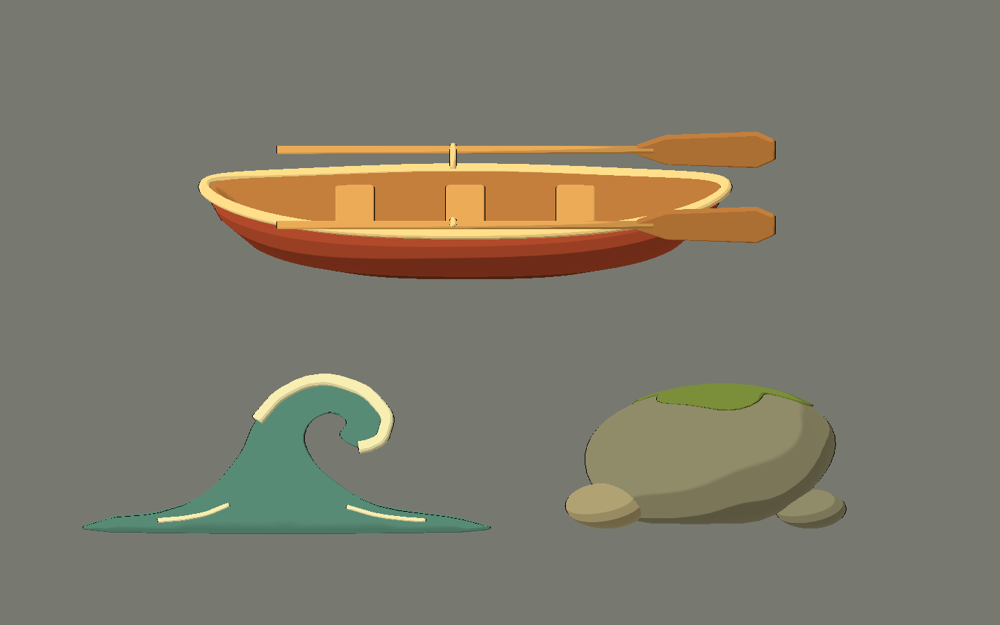
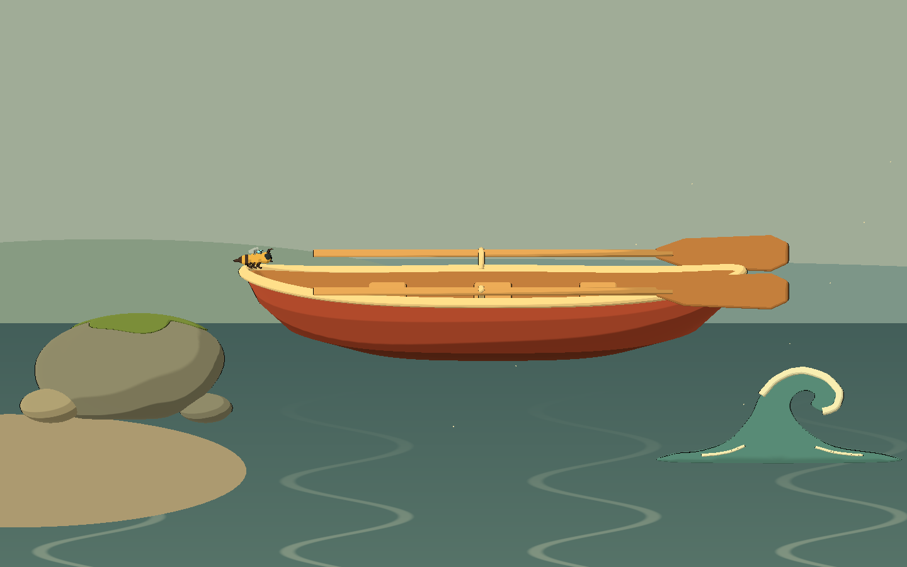

# Bee Alien — octava tanda: costa y objetos humanos

2026-10-10. Tres modelos originales con fuentes Blender, GLB y escenas visuales
para Godot 4.x Compatibility. Colores naturales, formas suaves, cel shading y
contorno fino. Sin texturas externas, marcas ni emisión cian/violeta.

## Probar

Abrir `scenes/art_labs/future_biomes_v08.tscn` y ejecutar con **F6**.

- **C / O / E**: costa, oleaje y estudio.
- **1–3** o «Ver una pieza»: barca, ola y roca.
- **V**: vista lateral / tres cuartos de la pieza individual.
- **H**: ocultar interfaz. Estudio y fichas quedan sin texto ni entorno.
- **P**: pausar el balanceo vertical de la barca en la galería.
- **Flechas**: cambiar página.




## Modelos

| ID | Diseño / uso | Triángulos fuente | Mallas |
|---|---|---:|---:|
| `coastal_rowboat` | Barca humana terracota, casco hueco de una sola envolvente cerrada, borda crema, tres bancos con soportes, tres tablas de suelo y dos remos separados con palas anchas. | 5.412 | 20 |
| `shore_wave_module` | Ola sólida con perfil curvado, volumen abombado, espuma crema continua y dos regueros discretos. Decoración de costa para cámara lateral. | 7.900 | 4 |
| `shore_rock` | Piedra cálida gris/oliva de forma asimétrica suave, dos guijarros y una capa cerrada de musgo que sigue su superficie. | 5.472 | 4 |

El manifiesto está en `assets/models/future_biomes_v08/manifest.json`. Los
triángulos cuentan las mallas fuente trianguladas, sin incluir el segundo pase
de contorno ni las instancias de las galerías. El generador comprueba aristas
manifold y caras con área positiva antes de guardar y exportar cada modelo.

## Perfil visual y construcción

Las escenas reutilizan `scripts/art/future_asset_visual.gd` y `BeeToonStyle`:
bandas toon, rim suave y contorno de prop. Los materiales originales de los
GLB son materiales de intercambio; instanciar las escenas visuales para obtener
el estilo del juego. No se modificaron los shaders compartidos.

La barca conserva interior real, fondo y grosor de casco. Los bancos atraviesan
el ancho interior; sus soportes y las tablas quedan dentro del casco. Los grupos
`Oar_Near` y `Oar_Far` permiten separar los remos desde Blender o una escena
heredada. El estudio inclina la barca para mostrar el interior; la ficha lateral
mantiene la orientación estricta del juego. Los dos remos coinciden parcialmente
en esa vista lateral por su disposición a ambos lados de la embarcación.

La ola tiene espesor y una curvatura suave de profundidad. Su espuma usa un
marco transportado a lo largo de la curva para evitar torsiones entre anillos.
El verde del agua es apagado y la espuma usa crema sin emisión. Es un módulo
decorativo con extremos afinados; no es una pieza de océano de unión continua.

El musgo sigue la misma función de superficie que la piedra y tiene grosor.
La asimetría de la roca procede de deformaciones amplias, sin ruido fino ni
texturas fotográficas. Las intersecciones entre piezas, como guijarros y roca,
son deliberadas; cada malla individual está cerrada.

La galería costera utiliza Bee existente como referencia de escala. Agua de
fondo, colinas, arena y partículas son elementos de composición para revisión,
no modelos adicionales exportados. La escala de estudio facilita comparar
diseños y se ajusta por instancia al integrar un nivel.

## Archivos creados y modificados

- `art_source/blender/future_biomes_v08/{ID}.blend`: tres fuentes y `.gdignore`.
- `assets/models/future_biomes_v08/{ID}.glb`: tres modelos, `.import` y manifiesto.
- `scenes/art_labs/assets_v08/{ID}.tscn`: tres escenas visuales reutilizables.
- `scenes/art_labs/future_biomes_v08.tscn`: galería aislada.
- `scripts/art/future_biomes_lab_v08.gd`: composición, selección y vistas.
- `tools/art/create_future_biomes_v08.py`: generador original reproducible.
- `tools/art/capture_future_biomes_v08.gd`: capturas del viewport.
- `tests/art/validate_future_biomes_v08.gd`: estructura, estilo y navegación.
- `docs/art/future_biomes_v08/*.png`: 12 capturas.
- Este informe y actualización de `docs/art/ENVIRONMENT_ROADMAP.md`.
- Godot genera `.gd.uid` e importaciones asociados; logs en `dev/future_biomes_v08_*.log`.

Esta tarea no editó gameplay, otras tandas ni otros proyectos, y no importó
assets de una biblioteca externa. Los cambios ajenos presentes en el workspace
se conservaron.

## Integración

Instanciar las escenas de `scenes/art_labs/assets_v08`. Plano visible **X/Y**,
arriba **+Y**, cámara desde **+Z** hacia el origen. Blender usa Z arriba y la
superficie frontal mira hacia -Y. Los orígenes están cerca de la base central
de cada modelo; no son marcadores precisos de contacto ni de línea de flotación.

La barca tiene dimensiones fuente aproximadas de 4,745 × 0,9 × 1,68 en Godot
(ancho × alto × profundidad), incluidos remos. Ajustar escala para representar
un objeto humano enorme respecto de Bee. Los grupos separados permiten editar
remos, bancos y soportes sin reconstruir el casco.

## Comprobaciones

Blender 5.2.1: tres `.blend` guardados y tres GLB exportados; todas las mallas
fuente cerradas y sin caras degeneradas. Godot 4.7.2 Compatibility / OpenGL 3.3,
Intel Arc B580:

- **0 fallos** en el validador final.
- Materiales toon y pase de contorno en las superficies de los tres props.
- Sin dispositivos alienígenas, luces ni emisión explícita en los modelos.
- Casco, borda, tres bancos, dos remos y dos palas presentes.
- Cuerpo de ola, espuma y musgo presentes.
- Tres páginas, vistas lateral/tres cuartos y fichas de una sola pieza sin UI.
- **12 capturas**: tres galerías con interfaz, tres limpias y seis fichas individuales.
- Revisión visual de estudio, costa, oleaje, barca lateral y ola/barca en tres cuartos.

```powershell
# Reconstruye sólo V08; sobrescribe sus fuentes y GLB.
& 'C:\Program Files\Blender Foundation\Blender 5.2\blender.exe' --background --python tools/art/create_future_biomes_v08.py
$beeGodot = 'C:\Users\rea_0\Downloads\Godot_v4.7.2-stable_win64.exe\Godot_v4.7.2-stable_win64_console.exe'
& $beeGodot --headless --path . --editor --import --quit
& $beeGodot --headless --path . --script tests/art/validate_future_biomes_v08.gd
& $beeGodot --path . --resolution 1440x900 --script tools/art/capture_future_biomes_v08.gd
```

## Límites y problemas

Son **POCs visuales**, sin colisiones, flotación física, deformación animada de
olas ni integración en niveles. El movimiento de barca es una oscilación de
galería. La ola es una forma ilustrada para vista lateral y tres cuartos
moderados, no una simulación de fluido. Preparar LOD y medir superficies al
repetir rocas/olas; la barca conserva piezas separadas para facilitar edición.

El entorno restringido informa que no puede crear caché de shaders en `user://`
y carpetas de configuración del editor en AppData. La importación terminó,
el validador dio 0 fallos y las capturas se generaron correctamente. No hubo
errores de script ni materiales nulos en la validación o captura final.
