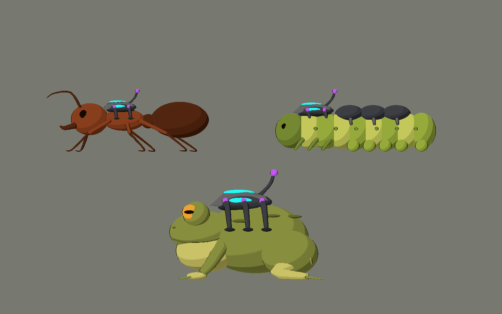

# Bee Alien — V09: implantes canónicos y suelo

2026-10-10. Primer POC de las nuevas prioridades del usuario. Fuentes `.blend`,
GLB y escenas visuales originales para Godot Compatibility.

| Modelo | Triángulos fuente | Mallas | Uso |
|---|---:|---:|---|
| `controlled_ant` | 13.456 | 17 | Enemiga de suelo común: seis patas, antenas acodadas y cintura reconocible. |
| `controlled_caterpillar` | 20.344 | 29 | Oruga de ocho segmentos, seis patas torácicas, diez propatas y tres placas externas. |
| `amphibian_mount_study` | 22.136 | 22 | Estudio original de sapo gigante, cuatro extremidades y montura dorsal ampliada. |
| `canonical_implant_kit` | 28.288 | 4 | Cuatro monturas de una misma familia, agrupadas para comparación/reutilización. |



## Probar

Abrir `scenes/art_labs/future_biomes_v09.tscn` y pulsar **F6**.
**C/S/E**: hoja canónica, suelo y estudio. **1–4**: piezas. **V**: lateral/tres
cuartos. **L**: poner/quitar tecnología. **H**: ocultar interfaz.
**F** o «Aire / cañón»: pasar a V10; **C** en V10 regresa a esta hoja.

La hoja muestra hormiga, ratón, paloma y sapo. El ratón y la paloma son geometría
propia de V04; sus monturas se sustituyen sólo en estas instancias. Los animales
conservan su anatomía al liberar; la oruga pierde también todas las placas.
La norma de construcción está en `CANONICAL_IMPLANTS_V01.md`.

## Archivos de esta tarea

- Cuatro fuentes y `.gdignore`: `art_source/blender/future_biomes_v09/`.
- Cuatro GLB, importaciones y manifiesto: `assets/models/future_biomes_v09/`.
- Cuatro escenas con toon: `scenes/art_labs/assets_v09/`.
- Galería: `scenes/art_labs/future_biomes_v09.tscn`.
- Galería y liberación del kit: `scripts/art/future_biomes_lab_v09.gd`, `canonical_implant_visual.gd`.
- Generador/captura: `tools/art/create_future_biomes_v09.py`, `capture_future_biomes_v09.gd`.
- Validador: `tests/art/validate_future_biomes_v09.gd`.
- 18 capturas y sus importaciones: `docs/art/future_biomes_v09/`.
- Esta documentación, norma de implantes y actualización de prioridades de arte.

## Comprobaciones y límites

Blender 5.2.1 comprueba mallas cerradas y caras no degeneradas antes de guardar.
Godot 4.7.2 Compatibility: **0 fallos**, toon/contorno, emisión sólo en tecnología,
anatomía intacta al liberar, cuatro variantes del kit y navegación de galería.
**18 capturas**: seis páginas con/sin UI, hoja liberada, ocho fichas de ángulo y
tres animales liberados. Agrupación de geometría conserva transformaciones de
los grupos escalados y reduce mallas de dispositivos y extremidades.

```powershell
$beeGodot = 'C:\Users\rea_0\Downloads\Godot_v4.7.2-stable_win64.exe\Godot_v4.7.2-stable_win64_console.exe'
& $beeGodot --headless --path . --script tests/art/validate_future_biomes_v09.gd
& $beeGodot --path . --resolution 1440x900 --script tools/art/capture_future_biomes_v09.gd
```

Plano de juego XY, arriba +Y, frente -X, cámara desde +Z; Blender usa Z arriba.
Instanciar las escenas visuales para obtener toon; los GLB solos usan materiales
de intercambio. Orígenes próximos al suelo; la escala de estudio no expresa
proporciones reales entre especies. El sapo es un estudio para el lago, no un
reemplazo del jefe OVNI actual.

Son visuales sin rig, colisiones, combate ni integración al Nivel 01. La oruga
no tiene aún resistencia al daño: su blindaje es una propuesta visual. Hace falta
reducir polígonos/preparar LOD y medir superficies antes de formar grupos numerosos.
La hoja canónica tampoco migra automáticamente la avispa jugable.

El entorno restringido informa falta de acceso a caché `user://` y configuración
AppData del editor. Importación y capturas funcionan; no hubo errores de script,
material nulo ni propiedad de nodos en la captura final. Se conservaron cambios
ajenos de gameplay y estilo, sin editar otros proyectos o importar bibliotecas.
