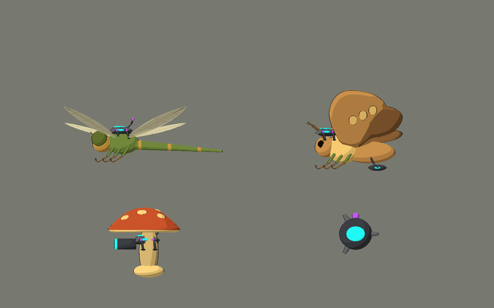
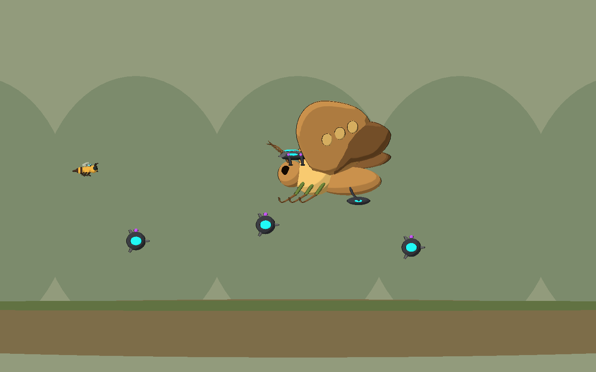

# Bee Alien — V10: vuelo y artillería de jardín

2026-10-10. Segundo POC de prioridad alta, posterior a la verificación de V09.
Tres enemigos visuales y una mina separada, con fuentes Blender y exportaciones
GLB para Godot Compatibility. Reutilizan el constructor de implantes de V09.

| Modelo | Triángulos fuente | Mallas | Diseño |
|---|---:|---:|---|
| `controlled_dragonfly` | 16.580 | 18 | Cuatro alas finas con nervaduras, ojos compuestos, seis patas y abdomen continuo con nueve secciones insinuadas. |
| `controlled_bomb_moth` | 23.592 | 18 | Cuatro alas cálidas con manchas naturales, antenas plumosas, seis patas y cargador alienígena removible. |
| `controlled_mushroom_cannon` | 11.822 | 5 | Hongo terracota/crema, sombrero cerrado y cañón horizontal grafito con boca cian y ánima oscura. |
| `moth_stationary_bomb` | 2.528 | 1 | Mina pequeña grafito con carga cian, espoleta violeta y tres estabilizadores. |




## Probar

Abrir `scenes/art_labs/future_biomes_v10.tscn` y ejecutar **F6**.

- **A/M/T/E**: vuelo ondulado, polilla/minas, hongo de suelo y estudio.
- **1–4** o selector: pieza individual.
- **V**: lateral/tres cuartos; **H**: ocultar interfaz.
- **L**: retirar tecnología conservando anatomía; **P**: pausar demostración.
- **Flechas**: cambiar página.
- **C** o «Implantes / suelo»: regresar a V09; **F** en V09 vuelve a V10.

## Demostraciones y lectura visual

La libélula avanza a 2,4 unidades/s en la galería, con ondulación vertical de
amplitud 0,55. Cruza de derecha a izquierda y reaparece fuera del encuadre.
Sus cuatro alas se abren en abanico para leerse lateralmente; membrana cálida
con el shader de alas existente y nervaduras naturales sin neón. El abdomen
es una sola malla: evita piezas solapadas que generen ruido o parpadeo.

La polilla avanza a 1,8 unidades/s y libera una mina visual cada 1,4 s desde
`BombDropAnchor`. Las minas quedan como nodos independientes del escenario,
sin seguir al insecto. Se retiran a los 5 s, con máximo de cinco. La página
incluye tres minas iniciales para revisar su escala incluso estando pausada.
Liberar la polilla oculta su cargador y receptor, y detiene nuevas liberaciones.
Las minas existentes se ocultan con la tecnología hasta que se retire la página.

El receptor de la polilla está adelantado junto a cabeza/tórax para evitar que
el ala cercana lo oculte. El cargador cuelga bajo el abdomen como una pieza
claramente ajena al insecto. Las manchas están presentes en ambas caras de las
alas; no son ventanas tecnológicas ni materiales emisivos.

El hongo permanece estático y conserva sombrero, tallo, base y manchas al liberar.
El cañón completo pertenece al dispositivo; `MuzzleAnchor` sirve como referencia
para futura salida de proyectiles. La boca tiene geometría de ánima, no un disco
cian plano. Vista lateral y tres cuartos muestran su espesor y borde activo.

La mina es un asset separado para instanciar desde el cargador o para un futuro
adaptador de gameplay. Aquí no se utiliza `UfoBossMine`: esa clase ya incluye daño
y explosión. La demostración es exclusivamente visual.

## Archivos creados

- Cuatro `.blend` y `.gdignore`: `art_source/blender/future_biomes_v10/`.
- Cuatro GLB, importaciones y manifiesto: `assets/models/future_biomes_v10/`.
- Cuatro escenas toon: `scenes/art_labs/assets_v10/`.
- Galería: `scenes/art_labs/future_biomes_v10.tscn`.
- Vistas y demostración: `scripts/art/future_biomes_lab_v10.gd`.
- Generador/captura: `tools/art/create_future_biomes_v10.py`, `capture_future_biomes_v10.gd`.
- Validador: `tests/art/validate_future_biomes_v10.gd`.
- 19 capturas y recursos de importación: `docs/art/future_biomes_v10/`.
- Este informe y actualización de prioridades/roadmaps de arte.

El generador importa únicamente helpers originales de `create_future_biomes_v09.py`;
no regenera V09 ni importa bibliotecas de assets. El validador reutiliza las
comprobaciones de estilo y liberación de V09. No se editaron shaders ni gameplay.

## Comprobaciones

Blender 5.2.1: cuatro fuentes y cuatro GLB, todas las mallas cerradas y sin caras
degeneradas. Godot 4.7.2 Compatibility / OpenGL 3.3, Intel Arc B580:

- **0 fallos** de estilo, estructura, navegación y demostración.
- Toon/contorno en sólidos; shader de membrana del proyecto en las alas de libélula.
- Emisión explícita cian/violeta sólo en tecnología; anatomía intacta al liberar.
- Cuatro alas y seis patas por insecto; cargador y cañón removibles.
- Vuelo con avance y ondulación; minas inmóviles, liberación y caducidad verificadas.
- **19 capturas**: ocho páginas con/sin UI, ocho vistas individuales y tres liberados.

```powershell
# Reexporta únicamente V10, usando el constructor común de V09.
& 'C:\Program Files\Blender Foundation\Blender 5.2\blender.exe' --background --python tools/art/create_future_biomes_v10.py
$beeGodot = 'C:\Users\rea_0\Downloads\Godot_v4.7.2-stable_win64.exe\Godot_v4.7.2-stable_win64_console.exe'
& $beeGodot --headless --path . --editor --import --quit
& $beeGodot --headless --path . --script tests/art/validate_future_biomes_v10.gd
& $beeGodot --path . --resolution 1440x900 --script tools/art/capture_future_biomes_v10.gd
```

## Integración y límites

Usar las escenas de `assets_v10` para obtener toon. Plano XY, arriba +Y,
frente -X y cámara desde +Z. Origen del hongo próximo a su base; insectos y mina
cerca del cuerpo central. Ajustar escala por instancia al Nivel 01.

Son **assets y demostraciones visuales**, sin rig, aleteo, hurtboxes, daño,
explosiones, IA o inserción en las oleadas del Nivel 01. Los patrones de galería
no implementan seguimiento de Bee, anticipaciones de ataque ni balance.
El hongo aún no dispara. Las minas de gameplay deben conservar las reglas de
aviso/daño/limpieza del jefe cuando se prepare ese POC de integración.

La polilla usa 23,6k triángulos como POC; preparar una variante reducida y medir
superficies antes de formar enjambres. Las alas translúcidas requieren revisar
orden de transparencia cuando se superponen varias criaturas.

Único aviso de captura: el entorno restringido no permite crear caché de shaders
en `user://`. El importador también informa falta de acceso a configuración del
editor en AppData. Exportación, importación y capturas terminaron; no hubo errores
de script ni materiales nulos en la ejecución final.
